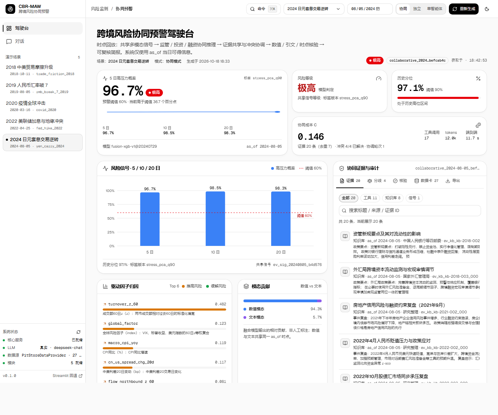
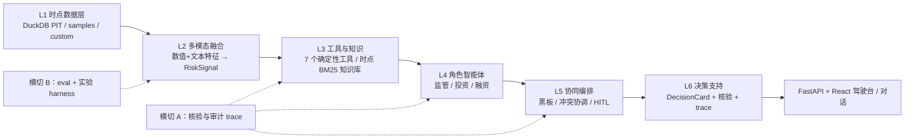

# CBR-MAW · 跨境金融风险多智能体协同预警系统

> 论文方向 2《跨境金融风险的多智能体协同预警：多模态信息融合视角》的工程原型：
> **确定性金融工具算数 + LLM 智能体编排 + 证据链核验 + 配置化消融实验**。

**一句话定位**：以「跨境金融市场压力高位状态」为唯一共同预警目标，让监管 / 投资 / 融资三类主体智能体在共享证据黑板上分工、互验、协调；所有数值由版本化工具计算、所有结论可溯源、所有协同过程可审计、所有模块可开关消融。

- 状态：可运行原型 ｜ 方法章 v0.8 ｜ 测试基线 **249 项**（2026-10-18 记录，以本机 `pytest -q` 为准）
- 默认数据：**SYNTHETIC 仿真数据**（确定性 DGP，仅用于演示与流程验证，不代表真实市场）



更多截图：[流式运行进度](docs/assets/screenshots/run-progress-light.png) · [命令面板 ⌘K](docs/assets/screenshots/command-palette-light.png) · [对话与引用](docs/assets/screenshots/chat-light.png) · [Dark 主题](docs/assets/screenshots/dashboard-dark.png)

---

## 1. 核心特性

| 能力 | 说明 |
|---|---|
| 共同预警目标 | 未来 5 / 10 / 20 个交易日进入高压力状态的概率、分位与驱动因子 |
| 三类主体智能体 | 监管（市场压力与外溢）、投资（组合尾部损失）、融资（融资成本与现金流压力） |
| 协同机制 | R0 独立分析 → R1 证据共享 → R2 交叉验证 → R3 分歧识别 → R4 冲突协调 → R5 决策卡 |
| 可信机制 | 数值由确定性工具计算（LLM 不产数值）；文本结论绑定时点过滤的知识库引文；越权工具调用被阻断；全链路审计 trace |
| 三模式对照 | `single` / `independent` / `collaborative` 走同一代码路径，资源预算对齐，可直接消融 |
| AI-native 交互 | React 驾驶台（SSE 流式运行、⌘K 命令面板、上下文追问、协同过程时间线、light/dark）；对话入口；Streamlit 回退 UI |
| 可复现实验 | `scripts/run_experiment.py` 跑 P1 模态消融、P2 工具/知识增强、P3 协同对照，产物落 `artifacts/runs/<run_id>/` |

---

## 2. 架构概览

六层流水线 + 两条横切能力（核验 / 评估），模块与实现一一对应，详见[架构设计 v1](docs/architecture/CBR-MAW_architecture_v1.md)。



- **L1 数据与时点**：`cbr.data`；装配优先级 custom → `data/pit.duckdb` → `data/samples`（SYNTHETIC）→ 内存仿真兜底；所有读取按 `as_of` 过滤（`release_time <= as_of`）。
- **L2 融合信号**：`cbr.features` + `cbr.models`；48 个数值特征 + 11 个文本特征，滚动样本外训练，输出共享 `RiskSignal`。
- **L3 工具与知识**：`cbr.tools`（7 个纯计算工具，权限矩阵 `default_deny`）+ `cbr.knowledge`（BM25 索引，双层时点过滤，返回 chunk 级引文）。
- **L4 智能体**：`cbr.agents` + `cbr.llm`（DeepSeek / Mock 同一接口，无 key 自动 Mock）。
- **L5 协同编排**：`cbr.orchestration` + `cbr.verification`；冲突三分类（fact / directional / preference），HITL 队列留痕。
- **L6 交互与 API**：`src/cbr/api`（同步 + SSE）+ `web/`（主 UI）+ `app/`（Streamlit 回退）。

---

## 3. 快速开始

前置：Python ≥ 3.11（验证于 3.12）、Bun ≥ 1.2（验证于 1.3.13）。前端可选——不构建 `web/dist` 时 API 与 Streamlit 仍可用。

### Windows（PowerShell）

```powershell
git clone https://github.com/Thecnfor/cbr-maw.git
cd cbr-maw

python -m venv .venv
.venv\Scripts\python.exe -m pip install -r requirements.txt
.venv\Scripts\python.exe -m pip install -e . --no-deps

# 构建 SYNTHETIC 样例数据与知识库索引
.venv\Scripts\python.exe scripts\build_sample_data.py
.venv\Scripts\python.exe scripts\build_knowledge.py

# 测试
.venv\Scripts\python.exe -m pytest -q

# 构建 React 驾驶台（可选，产 web/dist，由 FastAPI 托管到 /ui/）
cd web
bun install
bun run build
cd ..

# 启动服务
.venv\Scripts\python.exe -m uvicorn cbr.api.main:app --host 127.0.0.1 --port 8000
```

### Linux / macOS

```bash
git clone https://github.com/Thecnfor/cbr-maw.git
cd cbr-maw

python3 -m venv .venv
source .venv/bin/activate
pip install -r requirements.txt
pip install -e . --no-deps

python scripts/build_sample_data.py
python scripts/build_knowledge.py
pytest -q

cd web && bun install && bun run build && cd ..

python -m uvicorn cbr.api.main:app --host 127.0.0.1 --port 8000
```

服务启动后：

- 驾驶台（推荐）：<http://127.0.0.1:8000/ui/>（`?theme=dark` 强制深色，`?cmd=1` 自动打开命令面板）
- API 文档：<http://127.0.0.1:8000/docs>
- Streamlit 回退 UI：`.venv\Scripts\python.exe -m streamlit run app/dashboard.py --server.port 8501`
- 前端开发模式：`cd web && bun run dev`（<http://127.0.0.1:5173>，`/api` 代理到 8000）

可选：构建 DuckDB 时点库与逐日信号（首次约数分钟，加速后续请求）：

```powershell
.venv\Scripts\python.exe scripts\build_dataset.py
```

### 真实数据模式（v0.8）

用户提供的真实数据已接入为 `data/custom/`（**数据文件不入库**，由脚本从原始 zip / 飞书 / 公开接口重建）：

```powershell
# 1) 用户数据 zip 解压 + 飞书 Base / 文本语料下载（详见 docs/data/real_data_integration.md）
Expand-Archive docs\金融数据.zip data\raw\financial_data -Force
# 2) 公开缺口补齐（10Y/2Y 国债、信用利差、PMI、标普500、VIX、CNH、社融、外储、LPR 等）
.venv\Scripts\python.exe scripts\fetch_public_gaps.py --start 2015-01-01 --end 2025-09-30
.venv\Scripts\python.exe scripts\fetch_public_extra.py
# 3) 文本语料（9,758 篇，2017–2025）
.venv\Scripts\python.exe scripts\build_text_corpus.py
# 4) 合并为 custom 数据集 + 字段映射
.venv\Scripts\python.exe scripts\build_real_custom_data.py --report
# 5) 真实数据 PIT + 模型产物（独立 artifacts_real）
$env:CBR_CONFIG="configs/app.real.yaml"
.venv\Scripts\python.exe scripts\build_dataset.py --custom-only `
  --pit-db data/pit_real.duckdb --artifacts artifacts_real --demo-date 2024-08-05
# 6) 用真实数据启动服务（/ui 与 API 均使用真实快照）
.venv\Scripts\python.exe -m uvicorn cbr.api.main:app --host 127.0.0.1 --port 8000
```

真实数据不再回退仿真值（`configs/app.real.yaml` 中 `synthetic_fallback: false`）；默认
`configs/app.yaml` 保持 synthetic/auto 以便离线测试与复现。真实数据源、覆盖与时点口径见
[真实数据接入](docs/data/real_data_integration.md)、[文本语料](docs/data/text_corpus.md)、
[公开数据补齐](docs/data/public_gap_fill.md)。

分步说明与常见坑见 [快速开始指南](docs/guides/quickstart.md)。

---

## 4. 目录结构

```text
configs/                角色规范 roles.yaml、情景 scenarios.yaml、工具/知识库/实验配置
data/
  samples/              确定性仿真数据（SYNTHETIC，已入库）
  knowledge/            时点知识库语料（jsonl）与 BM25 索引
  custom/               用户自建数据（.gitignore 忽略）
  pit.duckdb            PIT 存储（运行时生成，忽略）
src/cbr/
  schemas.py            跨模块唯一数据契约（Evidence/Claim/RiskCard/DecisionCard/...）
  contracts.py          模块接口协议（DataProvider/Tool/KnowledgeBase/LLMClient/Orchestrator）
  service.py            服务装配（API / UI / 实验共用 build_service）
  data/ features/ models/   L1 时点数据、L2 多模态特征、融合风险信号（P1）
  tools/ knowledge/         L3 确定性金融工具、时点知识库 / RAG（P2）
  llm/ agents/              L4 DeepSeek/Mock 抽象、三角色智能体（P2/P3）
  orchestration/ verification/  L5 黑板/协同/冲突协调/HITL、核验与审计 trace（P3）
  eval/ api/                L6 指标与统计检验、FastAPI 服务（含 /ui 托管）
web/                    React 19 + Vite + Tailwind v4 驾驶台与对话（主 UI）
app/                    Streamlit 驾驶台 + 对话入口（回退 UI）
scripts/                数据构建、实验、文档渲染、流式验收等一次性/批处理脚本
tests/                  pytest 测试（数据/模型/工具/知识/智能体/编排/核验/API/流式/集成）
docs/                   架构、技术文档第四章、指南、设计契约、调研（见文档索引）
artifacts/              模型、trace、实验运行与导出（运行时生成，忽略）
```

---

## 5. API

| 方法 | 路径 | 说明 |
|---|---|---|
| GET | `/api/health` | 服务 / LLM / 数据源 / 核心模块就绪状态（永远 200） |
| GET | `/api/scenarios` | 历史压力情景列表 |
| GET | `/api/decision` | 生成一次多智能体预警决策卡（30 分钟缓存，`refresh=true` 强制重算） |
| GET | `/api/decision/stream` | 同上，SSE 推送 `run/stage/trace/decision` + 心跳 |
| POST | `/api/chat` | 自然语言对话（引用 + 关联决策卡） |
| POST | `/api/chat/stream` | 同上，SSE 推送 `run/stage/trace/chat` |
| GET | `/api/evidence/{evidence_id}` | 证据详情 |
| GET | `/api/data-cards` | 数据卡（序列口径 / 时点可得性） |
| GET | `/api/trace/{run_id}` | 审计轨迹事件列表 |

参数约定：`as_of=YYYY-MM-DD`、`scenario=<scenario_id>`、`mode=collaborative|independent|single`。核心未就绪时业务端点统一返回 **503 + 中文说明**。SSE 契约见 [流式接口备注](docs/design/streaming-api-notes.md)。

---

## 6. 配置与数据

**主要配置文件**：[configs/app.yaml](configs/app.yaml)（LLM / 数据 / 信号 / 编排 / 服务）、[configs/roles.yaml](configs/roles.yaml)（三主体规范与工具权限）、[configs/scenarios.yaml](configs/scenarios.yaml)（5 个历史压力情景）、[configs/tools.yaml](configs/tools.yaml)、[configs/experiments/](configs/experiments/)（P1/P2/P3 与消融矩阵）。

**环境变量**：

| 变量 | 作用 | 默认 |
|---|---|---|
| `DEEPSEEK_API_KEY` | DeepSeek API 密钥（也可写入 `secrets/deepseek.key`） | 空 → 自动 Mock LLM |
| `CBR_CONFIG` | 指定应用配置 YAML | `configs/app.yaml` |
| `CBR_WEB_DIST` | React 构建产物目录 | `web/dist` |
| `CBR_DECISION_CACHE_TTL` | 决策缓存 TTL（秒） | `1800` |
| `CBR_STREAM_TIMEOUT` / `CBR_STREAM_POLL_INTERVAL` / `CBR_STREAM_TRACE_RETENTION` | SSE 超时 / 轮询间隔 / trace 保留数 | `300` / `0.1` / `50` |

**DeepSeek 接入**：`$env:DEEPSEEK_API_KEY = "sk-..."`（或 `.env`、`secrets/deepseek.key`）后同一代码路径自动切真实模型；无 key 时 Mock 模式全流程离线可跑。

**真实数据（v0.8 已接入）**：快照覆盖 **2015-01-05 ~ 2025-09-30、2,615 个交易日、27 条规范序列、57,421 条观测、9,758 篇文本**；`dataset_snapshot_id=ds_94c8b84b60cd1248dd57`、`corpus_hash=corpus_a7e87cba9e85e67525ae`。数据来源与代理口径（北向资金流来自飞书 Base 07；北向 2024-08-16 后停披露即缺失；SHIBOR 1W 代理 7 天回购、AAA 中票代理 AA 信用利差等）见 [真实数据接入](docs/data/real_data_integration.md)。

**自建数据接入**：数据放入 `data/custom/`（CSV/Parquet），在 [configs/data_mapping.yaml](configs/data_mapping.yaml) 配置日期列、发布时点列、序列映射、频率与单位；真实数据实验使用 [configs/app.real.yaml](configs/app.real.yaml)（`dataset: custom`、`synthetic_fallback: false`、独立 `artifacts_real`），系统统一走 point-in-time 读取。扩展接入步骤见 [真实数据接入指南](docs/guides/real-data.md)。

> 未接入真实数据时自动回退 `data/samples/` 的**仿真数据**；真实数据实验建议设置 `data.synthetic_fallback: false`，避免仿真值混入。

---

## 7. 测试与实验

```powershell
# 全量测试（当前基线 249 项，2026-10-18 记录）
.venv\Scripts\python.exe -m pytest -q

# 实验：P1 模态消融 / P2 工具与知识增强 / P3 三模式协同对照
.venv\Scripts\python.exe scripts\run_experiment.py --kind p1
.venv\Scripts\python.exe scripts\run_experiment.py --kind p2 --p2-dates 4
.venv\Scripts\python.exe scripts\run_experiment.py --kind p3 --p3-dates 8
.venv\Scripts\python.exe scripts\run_experiment.py --kind all
```

产物在 `artifacts/runs/<run_id>/`（`p1.json/md`、`p2.json/md`、`p3.json/md`、`summary.md`）。指标、消融矩阵与结果解读见[实验指南](docs/guides/experiments.md)；试点结果见 [SYNTHETIC 试点](docs/techdoc/pilot_results_synthetic.md)、[真实 DeepSeek 复跑](docs/techdoc/pilot_results_real_llm.md) 与 **[真实数据试点](docs/techdoc/pilot_results_real_data.md)**。

**真实数据实验**（需先完成上一节接入；P1/P2/P3 均使用真实快照）：

```powershell
$env:CBR_CONFIG="configs/app.real.yaml"
.venv\Scripts\python.exe scripts\run_experiment.py --kind p1 --config configs/experiments/p1_modality.yaml --run-id p1_real_q90
.venv\Scripts\python.exe scripts\run_experiment.py --kind p2 --config configs/experiments/p2_augment.yaml --run-id p2_real
.venv\Scripts\python.exe scripts\run_experiment.py --kind p3 --config configs/experiments/p3_collaboration.yaml --run-id p3_real
```

> **数据声明**：默认样例数据为确定性仿真数据（用于测试与离线复现）；真实数据快照来自用户提供 zip、飞书 Base/文本语料与公开接口补齐，实验结论以 `pilot_results_real_data.md` 为准；两类结果严格分开，均不构成投资或监管建议。

---

## 8. 文档索引

| 你是谁 | 从这里开始 |
|---|---|
| 新访客 / 想先跑起来 | [快速开始指南](docs/guides/quickstart.md) |
| 开发者 / 贡献者 | [CONTRIBUTING.md](CONTRIBUTING.md) · [AGENTS.md](AGENTS.md) |
| 研究者 / 论文读者 | [技术文档第四章](docs/techdoc/chapter4_method.md) · [架构设计 v1](docs/architecture/CBR-MAW_architecture_v1.md) |
| 部署 / 运维 | [部署指南](docs/guides/deployment.md) · [故障排查](docs/guides/troubleshooting.md) |
| 数据接入 | [真实数据接入（v0.8 快照）](docs/data/real_data_integration.md) · [文本语料](docs/data/text_corpus.md) · [公开数据补齐](docs/data/public_gap_fill.md) · [接入指南](docs/guides/real-data.md) |
| 前端 / 设计 | [web/README.md](web/README.md) · [web/DESIGN-NOTES.md](web/DESIGN-NOTES.md) |
| 团队协作 | [团队协作指南](docs/guides/team-collaboration.md) · [任务清单](docs/techdoc/open_issues.md) |

完整导航（按角色分类）见 [docs/INDEX.md](docs/INDEX.md)。

---

## 9. 许可证与免责声明

- 许可证：**MIT**，详见 [LICENSE](LICENSE)（Copyright © 2026 Thecnfor）。
- 安全性：漏洞报告流程见 [SECURITY.md](SECURITY.md)；行为准则见 [CODE_OF_CONDUCT.md](CODE_OF_CONDUCT.md)。
- **免责声明**：本项目为研究性原型，输出为风险提示与研究结论，**不构成投资建议、不构成监管决定**。默认数据为仿真数据，不得用于任何真实决策；接入真实数据后的结论需自行校验。
