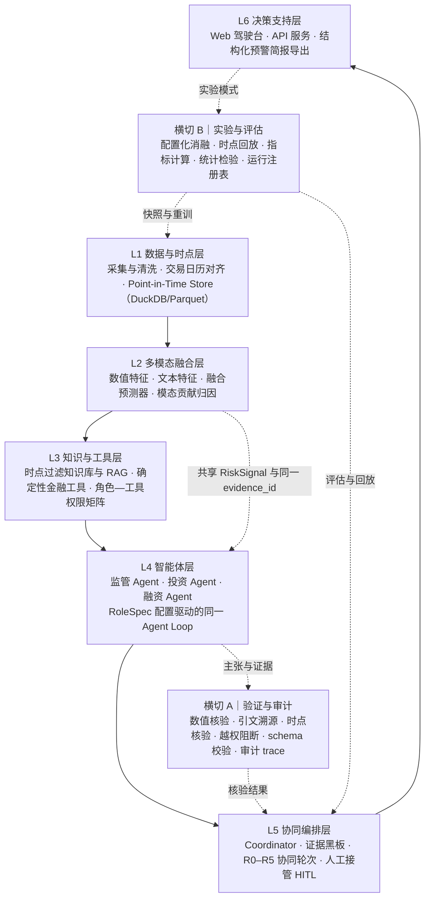
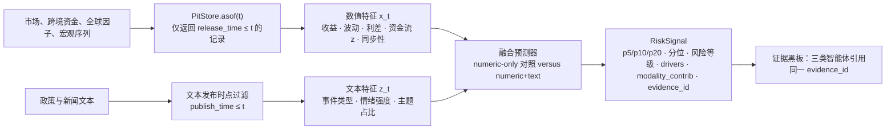
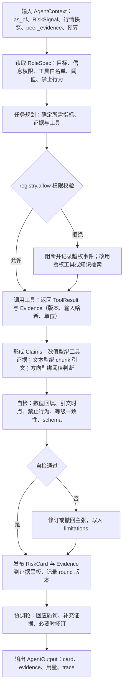
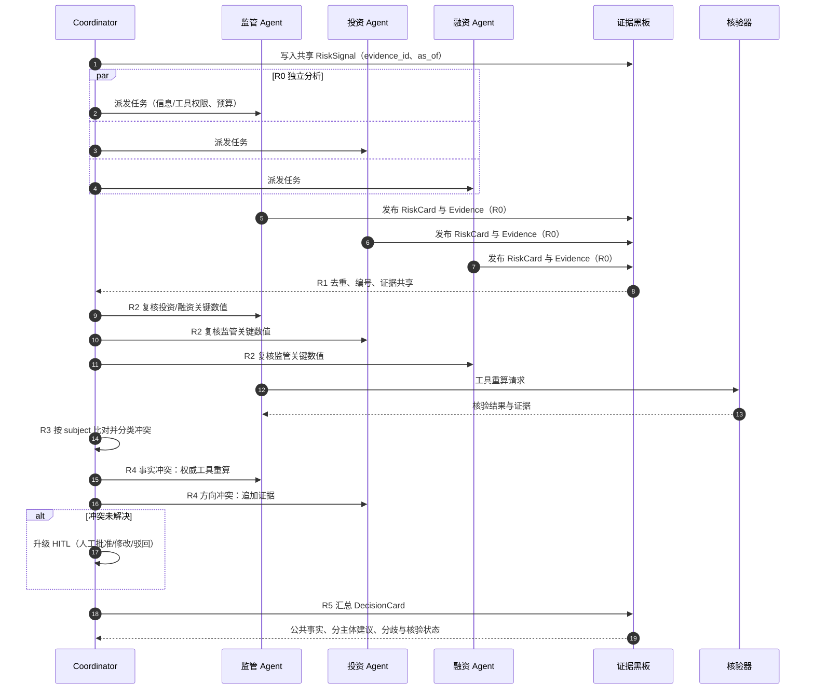
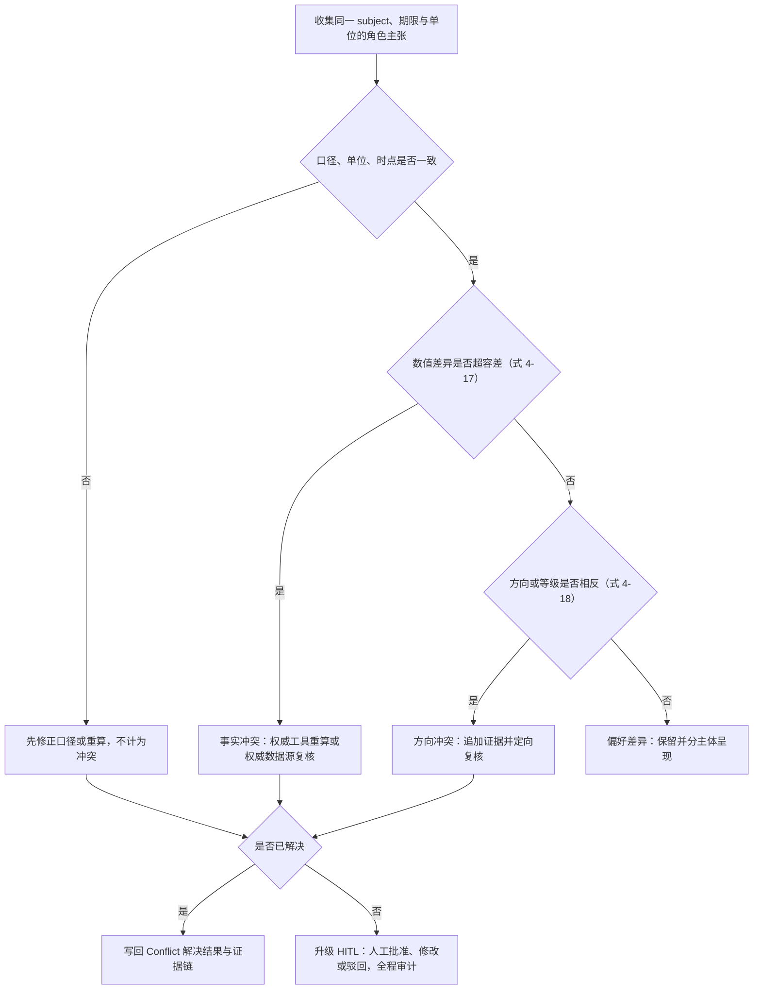

# 第四章 多模态多智能体协同预警方法

> 本章为 CBR-MAW 技术文档的方法章。文中类名、字段名、工具名与配置项以 `src/cbr/` 实现与 `configs/` 配置为准；凡涉及实证结论之处，仅陈述可检验含义与评价口径，实测结果见第五章实验设计与第六章结果分析。

本章提出面向跨境金融风险预警的多模态多智能体协同方法。与将预警视为单一预测任务的传统思路不同，本章把预警理解为三个相互衔接的层次：其一，由数值—文本多模态信息融合形成三类主体共享的风险基础信号；其二，由金融知识检索与确定性金融工具为信号提供可溯源、可重算的证据支撑；其三，通过监管、投资与融资三类专业化智能体的分工、证据共享与分歧协调，将公共风险信号转化为主体差异化的预警与决策支持信息。方法设计同时服务于三个研究命题：多模态信息是否带来增量预警能力（P1）、金融知识与专业工具能否降低数值错误与无依据断言（P2）、专业化分工与协同机制能否在可比资源预算下降低预警与决策损失（P3）。

本章结构如下：4.0 给出方法总览与设计原则；4.1 界定多模态风险信息融合；4.2 讨论金融知识增强与专业工具调用；4.3 设计三类预警智能体；4.4 给出多智能体协同与决策支持机制；4.5 说明实现组织与可复现性；附录给出接口清单、配置示例与术语表。各方法模块均标注其对应命题与实验章节；凡涉及实证结论之处，仅陈述可检验含义。

## 4.0 方法总览与设计原则

### 4.0.1 预警任务的形式化

跨境金融风险预警的困难不在于单点预测，而在于风险信息异构、主体目标差异与结果难以核验三者叠加。为此，本章将预警任务形式化为一个受时点约束的映射：对任意评估日 $t$，方法在 $t$ 时点实际可得的信息集 $I_t$ 下，生成面向三类主体的决策支持产物 $D_t$。记主体集合 $\mathcal{R}=\{\text{regulator},\text{investor},\text{financing}\}$，则

$$
\mathcal{M}: I_t \times \mathcal{R} \rightarrow D_t,\qquad
I_t=\{x_{k,s},\ \text{doc}_j:\ \text{release\_time}\le t,\ \text{publish\_time}\le t\}
\tag{4-1}
$$

其中 $x_{k,s}$ 为第 $k$ 个数值序列在日期 $s$ 的取值，$\text{doc}_j$ 为第 $j$ 篇政策或新闻文本。式（4-1）的实质约束在于信息集的时点下标：任何进入 $I_t$ 的数据、文本、知识片段与模型版本，都必须在 $t$ 时点已经可得。该约束由 4.1 的时点数据层与 4.2 的知识库过滤共同实现，并由横切验证机制（4.4）以泄漏事件计数的方式监督。

预警任务的输出 $D_t$ 不是单一风险等级，而是包含三层次信息的结构化决策卡：①公共风险基础信号，即 5、10、20 个交易日高压力概率、历史分位、驱动因子归因与模态贡献；②三类主体各自的风险等级、关键证据、建议与局限；③协同过程信息，包括冲突、核验状态、人工复核标记与协同成本。三层次分别对应 P1、P3 与 P2 的可检验对象，从而避免以预警准确率替代解释可靠性与决策价值的评价。本章主要符号见表 4-1。

表 4-1 本章符号表

| 符号 | 含义 | 取值/维度 | 主要出现位置 |
|------|------|-----------|--------------|
| $t$ | 评估日（as_of 时点） | 交易日 | 全文 |
| $h$ | 预测期限 | $h\in\{5,10,20\}$ 个交易日 | 4.1、4.5 |
| $W$ | 滚动估计窗口 | 默认 500 个交易日 | 4.1 |
| $q$ | 高位状态分位阈值 | 默认 0.90 | 4.1 |
| $SPI_t$ | 跨境金融压力指数 | 实数 | 4.1 |
| $\tau_t$ | 滚动分位阈值 | 实数 | 4.1 |
| $y_{t,h}$ | 高压力状态标签 | $\{0,1\}$ | 4.1、4.5 |
| $x_t$ | 数值特征向量 | $\mathbb{R}^{d_n}$ | 4.1 |
| $z_t$ | 文本特征向量 | $\mathbb{R}^{d_t}$ | 4.1 |
| $p_{t,h}$ | 高压力概率预测 | $[0,1]$ | 4.1 |
| $\phi_m$ | 模态 $m$ 的归因贡献 | 实数 | 4.1 |
| $e$ | 证据（Evidence） | 证据对象 | 4.2、4.4 |
| $c$ | 主张（Claim） | 主张对象 | 4.2、4.3 |
| $\rho_r$ | 主体 $r$ 的角色规范 | RoleSpec | 4.3 |
| $I_r,T_r$ | 角色信息权限、工具权限 | 集合 | 4.3 |
| $\Theta_r,\lambda_r$ | 角色阈值、决策损失权重 | 字典 | 4.3 |
| $a_{r,t}$ | 角色 $r$ 在 $t$ 的预警动作 | $\{0,1\}$ | 4.3、4.5 |
| $L_r$ | 角色 $r$ 的决策损失 | 非负实数 | 4.3、4.4 |
| $C$ | 协同成本 | 非负实数 | 4.4、4.5 |
| $\mathcal{E}$ | 评估日集合 | 交易日集合 | 4.5 |
| $B$ | 重复抽样次数 | 默认 1000 | 4.5 |

### 4.0.2 五条设计原则

为使方法能够被独立消融、严格比较与复现，系统在结构上遵守五条设计原则。五条原则并非工程偏好，而是分别对应论文命题的可检验性条件；违反其中任何一条，都会使相应命题的检验失去解释力。

**原则一：单一风险锚。** 三类主体共享同一基础风险信号，角色差异只体现在目标函数、信息权限、工具权限、阈值、输出与决策损失上。该原则保证 P1 与 P3 的可比性：若各角色自行构造风险标签，则主体间差异将混入信号差异，无法区分协同增益与标签差异。实现上，融合预测器输出唯一的 RiskSignal，三份 RiskCard 均通过 `base_signal_ref` 引用同一 `evidence_id`。

**原则二：数值不由大语言模型生成。** 所有进入预警结论的数值均来自版本化的确定性工具或融合预测器；大语言模型只负责任务规划、工具选择、结果解释与跨证据比较。该原则服务 P2：每条数值主张必须绑定工具证据并可重算，从而使数值错误率成为可观测、可优化的指标，而非不可验证的文本质量判断。

**原则三：证据是一等数据结构。** 系统以统一的 Evidence 与 Claim 结构承载证据与主张，证据携带来源、发布时间、口径、单位、工具版本与输入哈希。文本证据强制满足 `publish_time <= as_of`。该原则既是 P2 引文核验的前提，也是 4.4 冲突仲裁“以证据等级而非角色权威定胜负”的基础。

**原则四：协同是开关式、可消融的模块。** 单智能体、三个独立智能体与完整协同系统共享同一代码路径，仅通过实验配置切换；工具调用次数、token 预算与信息集在三个模式间保持一致。该原则使 P3 的协同增益能够被识别为“分工、共享、协调”三类机制的独立贡献，而非资源投入差异的副产品。

**原则五：时点回放是一等公民。** 所有数据访问统一经由带 `as_of` 参数的时点接口完成，滚动重训按固定频率执行，文本检索在知识与数据两层分别做时点过滤。该原则使 5.1 的历史时点回放与 6.4 的稳健性分析具有方法上的可复现性，并把“未来信息泄漏”由不可观测的隐患转化为可计数的泄漏事件。

### 4.0.3 总体架构

方法的总体架构由六个功能层与两条横切机制构成（图 4-1）。L1 数据与时点层负责采集、清洗、对齐与点对点存储，是全部信息可得性约束的物理承载；L2 多模态融合层由数值分支与文本分支构成，输出带归因的共享风险信号；L3 知识与工具层提供时点过滤的知识库检索与确定性金融工具，是数值与引文的唯一来源；L4 智能体层以同一 Agent Loop、不同 RoleSpec 实例化监管、投资与融资三类智能体；L5 协同编排层负责证据黑板、R0–R5 协同轮次、冲突仲裁与人工接管；L6 决策支持层将结构化决策卡转化为可审查的预警简报与可演示的驾驶台界面。

两条横切机制贯穿所有层：横切 A（验证与审计）实施数值核验、引文溯源、时点核验、越权阻断、schema 校验与审计留痕，是 P2 指标的运行时来源；横切 B（实验与评估）负责配置化消融、时点回放、指标计算、统计检验与运行注册表，是第五章实验设计的软件化表达。分层与横切的划分对应论文方法结构：L1–L2 对应 4.1，L3 对应 4.2，L4 对应 4.3，L5 与横切 A 对应 4.4，横切 B 对应 4.5。



图 4-1 CBR-MAW 总体架构（六层两横切）

需要强调的是，图 4-1 中箭头的方向表达的是“依赖”而非“替换”：L5 的协调机制可以要求补充证据、发起重算或升级人工，但不能覆盖工具输出的确定性数值；L6 的界面可以改变呈现方式，但不能改变证据内容。这一约束把“可解释”落实为“可追溯、可重算、可审计”，而非停留于自然语言说明的层面。

### 4.0.4 方法—命题—实验的对应关系

表 4-2 给出本章各方法模块与 P1–P3、实验配置及评价指标的对应关系。该表是本章与论文第五章、第六章衔接的总索引：方法部分的每一处设计，都应能在实验部分找到对应的对照配置与指标口径；反之，实验中每一个结论，都应能追溯到具体的方法模块。

表 4-2 方法模块、研究命题与实验检验的对应关系

| 方法模块 | 关键设计 | 命题 | 可检验含义（预期方向，待实验） | 实验配置 | 实验章节 | 核心指标 |
|----------|----------|------|------------------------------|----------|----------|----------|
| 4.1 多模态融合 | 数值与文本时点对齐、融合预测器、模态归因 | P1 | 文本模态在数值基础上提供样本外增量 | E1 numeric-only / E2 numeric+text | 5.1、5.2、6.1 | PR-AUC、top-decile 召回、Brier、ECE、预警提前期 |
| 4.2 知识增强 | 时点知识库、chunk 引文链、RAG | P2 | 降低无依据断言、提高证据准确率 | E3 基础模型 / E4 +RAG | 5.2、5.3、6.2 | 无依据断言率、证据准确率 |
| 4.2 工具增强 | 确定性工具契约、权限矩阵、数值核验 | P2 | 降低数值错误，越权调用被阻断 | E3 / E5 +工具 / E6 +RAG+工具 | 5.2、5.3、6.2 | 数值错误率、越权阻断次数、schema 失败率 |
| 4.3 专业化分工 | 三份 RoleSpec、差异化目标与权限 | P3 基础 | 单一通用体难以同时满足三类目标 | E7 单智能体 / E8 三独立体 / E9 协同体 | 5.2、6.3 | 任务完成率、主体决策损失 |
| 4.4 证据共享 | 证证据黑板、去重、共享证据 | P3 | 共享降低重复证据与信息遗漏 | E9 与关闭证据共享的消融 | 6.3 | 决策损失、重复证据率 |
| 4.4 交叉验证与冲突协调 | R2 复核、R3 分类、R4 仲裁 | P3 | 冲突解决率提高、分歧不再遗漏 | E9 与逐项关闭协调的消融 | 6.3 | 冲突解决率、数值错误率、决策损失 |
| 4.4 人工接管与审计 | HITL 触发规则、审计 trace | P2/P3 | 高风险与未解决冲突可复核 | 全部配置 | 5.3、6.4 | 人工复核触发率、可复现率 |

围绕论文的三个核心问题，本章的回答位置如下：“为什么是三个智能体”在 4.3.1 通过角色规范的六元组差异与专业化分工的可检验设计回答；“协同增益如何检验”在 4.4.5 通过三模式对照、机制逐项消融与成本调整后的决策损失回答；“如何防止数值错误、无依据断言与时点泄漏”在 4.2.3、4.3.4、4.4.4 与 4.5 分别给出数值核验、引文核验、时点核验、越权阻断与审计留痕的规则与指标。

## 4.1 多模态风险信息融合

【对应命题 P1；实验章节：5.1、5.2、6.1；实现：L1 数据与时点层、L2 多模态融合层、`src/cbr/data/`、`src/cbr/features/`、`src/cbr/models/`】

本节解决“用什么信息、在什么时点、以何种方式形成共享风险信号”的问题。方法分为四个环节：数据域界定与风险标签构造（4.1.1）、时点对齐与防泄漏（4.1.2）、数值与文本特征表示（4.1.3）、融合预测与模态归因（4.1.4），最后给出 P1 的可检验设计（4.1.5）。需要事先说明写作边界：本文的多模态指数值与文本两类模态；同一新闻主题下不同网站转载不构成新增模态，若后续引入音频、图像等数据，才扩展为更广的多模态设定。

### 4.1.1 数据域与风险标签

预警目标是跨境金融市场压力高位状态，而非汇率波动、企业违约或金融体系风险的混合体。为把该目标转化为可计算、可评价的标签，首先界定数据域。数据域按经济含义划分为五组（表 4-3），每组序列在进入建模前均须登记数据卡（DataCard），记录序列口径、来源、频率、覆盖期、发布滞后与时点可得性评级（strict / approximate / unavailable）。数据卡的作用不是文档装饰，而是时点回放的合法性凭证：评级为 unavailable 的序列不得进入任何评估日的信息集。

表 4-3 数据域、序列与用途

| 数据域 | 典型序列 | 频率 | 时点评级要求 | 主要用途 | 主要服务角色 |
|--------|----------|------|--------------|----------|--------------|
| 中国市场 | 沪深300、中证500、国债收益率曲线、信用利差、成交与换手 | 日 | strict/approximate | 压力指数、波动与尾部风险测度、标签 | 监管、投资 |
| 跨境资金 | 沪深港通北向/南向资金流、持仓与成交、AH 溢价 | 日 | strict | 异常资金流、同步撤离、连通性 | 监管、投资 |
| 全球因子 | 标普500、VIX、MOVE、美元指数、USDCNY/CNH、中美利差 | 日 | strict | 外部冲击与溢出、汇率敞口 | 监管、投资、融资 |
| 宏观 | PMI、社融、外储、政策利率 | 月/日 | approximate | 背景变量、融资环境 | 监管、融资 |
| 文本 | 央行、证监会、外管局、国务院政策文本，财经新闻标题，事件流 | 日/事件 | strict（按发布时间） | 文本模态：政策不确定性、资本管制、外部冲击 | 全部 |

在此基础上构造跨境金融压力指数。对第 $k$ 个标准化子指标，采用滚动窗口构造 $z$ 分数并加权合成：

$$
SPI_t=\sum_{k\in\mathcal{K}} w_k z_{k,t},\qquad
z_{k,t}=\frac{x_{k,t}-\mu_{k,t}^{(W)}}{\sigma_{k,t}^{(W)}}
\tag{4-2}
$$

其中 $\mathcal{K}$ 为压力指标集合（股票、债券、汇率、信用利差、跨境资金与全球波动），$W$ 为滚动窗口（默认 500 个交易日），$\mu_{k,t}^{(W)}$ 与 $\sigma_{k,t}^{(W)}$ 只用 $t$ 之前的数据估计，从而保证标准化过程本身不引入未来信息。权重 $w_k$ 可由滚动第一主成分（符号对齐后）或等权复合给定；具体版本由标签版本号确定，并在稳健性分析中替换（见 6.4）。

高位状态的判定不采用全样本分位，而采用滚动分位阈值：

$$
\tau_t=\operatorname{Quantile}_{q}\big(\{SPI_s:\ s\in[t-W,t-1]\}\big),\qquad q=0.90
\tag{4-3}
$$

$$
y_{t,h}=\mathbb{1}\Big\{\exists\, j\in\{1,\dots,h\}:\ SPI_{t+j}\ge\tau_t\Big\}
\tag{4-4}
$$

式（4-4）表示“未来 $h$ 个交易日内至少有一日进入高位状态”，$h\in\{5,10,20\}$。阈值 $\tau_t$ 只依赖 $t$ 之前的信息，标签 $y_{t,h}$ 只用于评估阶段（实现中由 `DataProvider.label` 提供），不进入特征或工具调用。标签版本写入配置项 `data.label_version`，当前默认为 `stress_pca_q90`，同时记录于 `RiskSignal.label_version`，以保证训练、评估与文档三处的标签口径一致。标签构造本身具有主观性（指标集合、权重方案、分位阈值均可替换），本章不预设某一构造绝对正确，而是将其作为可替换设计纳入稳健性分析。

### 4.1.2 时点对齐与防泄漏

多模态预警的效度首先取决于信息是否真的“事前可得”。系统为每条数据记录三个时间属性：观测时间 `obs_date`、实际可获得时间 `release_time` 与评估时点 `as_of`，并规定唯一合法访问规则：

$$
\text{available}(x_{k,s},t)=\mathbb{1}\{\text{release\_time}(x_{k,s})\le t\},\qquad
\text{available}(\text{doc}_j,t)=\mathbb{1}\{\text{publish\_time}(\text{doc}_j)\le t\}
\tag{4-5}
$$

数值侧的数据与时点层以 `PitStore.asof(series_id, as_of)` 为统一入口，仅返回满足式（4-5）的记录；对存在修订的宏观与资金数据，采用首次发布值或显式记录修订版本，禁止以最终修订值回填历史。文本侧在数据层与知识检索层分别执行发布时间过滤，形成“双保险”：前者防止文本进入特征计算，后者防止文本进入证据引用。交易日历方面，盘后发布的信息最早只能用于下一交易日的决策，月度数据的发布滞后通过 `release_lag_days` 显式建模；评级为 approximate 的序列在敏感性分析中单独报告，以检验结论对时点近似的稳健性。

滚动训练与评估协议进一步约束信息边界：模型按固定频率重训（`signal.retrain_every=20` 个交易日），每次重训只用当次重训时点之前的数据；评估窗口从固定起点开始（P1 实验配置 `eval_start=2021-01-01`），评估日集合 $\mathcal{E}$ 在运行配置中固定并登记，避免因评估日选择产生比较偏差。

历史回放的泄漏风险可归纳为三类：①数值修订泄漏，即使用事后修订数据；②文本事后发布泄漏，即引用尚未公开发布的文本；③模型预训练知识泄漏，即大语言模型在训练语料中已见过评估期事件。前两类可由式（4-5）与滚动重训在机制上消除，并以 `leakage_events` 计数监督；第三类只能通过受控实验设计（如限制模型版本、时间截断提示、与无预训练基线对照）部分缓解，无法完全消除，这一点在 5.1 与 4.5 的已知限制中如实说明，不作过度承诺。

### 4.1.3 数值特征与文本特征

数值分支以“水平—变化—波动—结构”四类特征刻画风险状态。设原始序列经时点对齐后为 $\tilde{x}_{k,t}$，则在 $t$ 时点的特征向量为

$$
x_t=\Big[\underbrace{\Delta\tilde{x}_{k,t}}_{\text{收益/变化}},
\underbrace{\mathrm{vol}_W(\tilde{x}_k)_t}_{\text{已实现波动}},
\underbrace{\mu_W(\tilde{x}_k)_t}_{\text{滚动均值}},
\underbrace{\text{spread}_t,\ \text{flow\_z}_t,\ \text{corr}_t,\ \text{concentration}_t}_{\text{利差、资金流异常、同步性与集中度}}\Big]
\tag{4-6}
$$

其中资金流异常 $z$ 分数刻画北向/南向资金相对滚动分布的偏离，同步性刻画跨境资金与权益市场同向变动的程度，集中度刻画资金流在行业与个股层面的集中。所有特征只用窗口 $W$ 内的数据构造，缺失值按“前值填充 + 缺失指示变量”处理，并在数据卡中记录缺失比例，避免以插值掩盖可得性问题。

文本分支的目标是把政策与新闻文本压缩为与风险状态相关的低维表示。设 $t$ 时点可得的文本集合为 $\mathcal{D}_t=\{\text{doc}_j:\text{publish\_time}_j\le t\}$，先按事件类型（货币政策、资本管理、外部冲击、监管处罚等）与主题（政策不确定性、汇率、跨境资金、信用风险）分类，再以时间衰减加权聚合情绪与主题强度：

$$
z_t=\Big[\sum_{j\in\mathcal{D}_t} e^{-\gamma(t-\text{publish\_time}_j)}\,\text{sent}_j,\ \
\{\text{share}_{m,t}\}_{m\in\mathcal{M}},\ \
\text{uncertainty}_t\Big]
\tag{4-7}
$$

其中 $\text{sent}_j$ 为文本 $j$ 的情绪得分，$\gamma>0$ 为时间衰减系数，$\text{share}_{m,t}$ 为主题 $m$ 在窗口内的占比，$\text{uncertainty}_t$ 为政策不确定性度量。需要特别指出，不把“数值语义化”（如将收益率变化转换为“大幅上行”标签）视为新增模态或新增信息：语义化标签只是数值的另一种编码，其增量信息应通过消融实验单独检验，而不能在方法层面预先宣称。

### 4.1.4 融合预测器与模态贡献归因

数值分支与文本分支的组合方式直接决定 P1 的检验对象。设数值特征预测器与文本特征预测器分别为 $g_n(x_t)$ 与 $g_t(z_t)$，本章比较三类融合策略：

$$
p_{t,h}=
\begin{cases}
\sigma\big(\beta_0+\beta_n^{\top}x_t+\beta_t^{\top}z_t\big), & \text{晚期融合（概率/特征级线性组合）}\\
\sigma\big(\beta^{\top}[x_t;z_t]\big), & \text{早期融合（特征拼接）}\\
\sigma\big(\beta_0+\beta_1 g_n(x_t)+\beta_2 g_t(z_t)\big), & \text{堆叠融合}
\end{cases}
\tag{4-8}
$$

其中 $\sigma(\cdot)$ 为 logistic 链接函数。实现上以梯度提升树（XGBoost）为基线模型（`signal.baseline=xgboost`），模型版本记为 `signal.model_version=fusion-xgb-v1`；概率输出经校准（如等渗回归）后使用，以降低概率系统性偏高或偏低对阈值决策的影响。融合预测器对每个预测期 $h$ 分别输出概率，并构造统一的风险信号：

RiskSignal 包含 `as_of`、`model_version`、`horizons`（5/10/20 日概率）、`percentile`（当前压力分位）、`level`（低/中/高/极高）、`drivers`（驱动因子及贡献与方向）、`modality_contrib`（数值与文本模态贡献占比）、`label_version` 与 `evidence_id`。该信号写入证据黑板，三类智能体引用同一 `evidence_id`，从而在结构上保证“单一风险锚”：主体差异只能来自其目标、权限与阈值，不能来自信号本身的差异。

模态贡献与驱动归因用于解释“预测由何而来”。对模态 $m\in\{\text{numeric},\text{text}\}$，以归因值 $\phi_f$ 聚合其所属特征：

$$
\phi_m=\sum_{f\in\mathcal{F}_m}\phi_f,\qquad
c_m=\frac{|\phi_m|}{\sum_{m'}|\phi_{m'}|}
\tag{4-9}
$$

其中 $\mathcal{F}_m$ 为模态 $m$ 的特征集合，$c_m$ 即 `modality_contrib` 的取值；驱动因子按 $|\phi_f|$ 排序取前若干项，并保留贡献方向（`RiskDriver.direction`）。必须说明，这类归因是模型解释而非因果识别：它回答“预测在多大程度上依赖某模态/某因子”，不回答“该因子是否在因果意义上导致风险”；方法上以“解释性归因”定位，避免在管理含义上过度外推。

### 4.1.5 P1 的可检验设计

P1 检验的核心是“在传统金融指标基础上，融合事前可得的多模态风险信息能否改善样本外预警表现”。为此，P1 实验（配置见 `configs/experiments/p1_modality.yaml`，run_id 为 `p1_modality_v1`）只评估融合预测器、不启用大语言模型与智能体（`agents.mode=offline`），从而把信息效应与智能体效应分离。两组配置仅模态开关不同：E1 为 numeric-only（`modality.numeric=true, text=false`），E2 为 numeric+text；标签版本、预测期限、评估窗口、滚动重训频率与随机种子保持一致。

评价指标包括：PR-AUC（高压力事件稀疏条件下的主指标）、top-decile 召回率（`recall_at_top_decile`，对应预警资源有限时的实际可用性）、Brier 分数与期望校准误差（ECE，衡量概率校准）、预警提前期（`lead_time_days`，仅对命中的压力事件计算，详见 4.5 指标定义）。增量效应定义为同一评估日集合上的配对差：

$$
\Delta_{\text{P1}}=\text{metric}(E2)-\text{metric}(E1)
\tag{4-10}
$$

并以配对 bootstrap 构造置信区间（默认 1000 次重抽样），检验 $\Delta_{\text{P1}}$ 是否显著异于零。该设计同时要求报告分期限（5/10/20 日）、分压力状态（高波动期与平稳期）与文本源替换（政策文本单独、新闻单独）的结果，以识别文本模态的适用边界。若 $\Delta_{\text{P1}}$ 在部分期限或状态下不显著，同样构成有价值的研究发现：它限定了多模态信息的适用条件，而不是对 P1 的简单证伪。



图 4-2 多模态融合数据流与 P1 消融对象
## 4.2 金融知识增强与专业工具调用

【对应命题 P2；实验章节：5.2、5.3、6.2；实现：L3 知识与工具层、横切 A、`src/cbr/knowledge/`、`src/cbr/tools/`】

大语言模型在风险预警中的两类典型失败，是数值幻觉与无依据断言：前者表现为生成看似合理但无法复算的数字，后者表现为给出无法对应到公开文本的判断。本节的方法对策是把“计算”与“引用”从生成过程中剥离：数值一律交由确定性金融工具计算，事实与规则一律由时点过滤的知识库检索提供，语言模型只承担规划、选择、比较与解释。由此，4.2.1 讨论知识库构建与检索，4.2.2 定义工具契约与权限矩阵，4.2.3 给出数值核验与无依据断言度量，4.2.4 明确语言模型与工具的职责边界，并给出 P2 的消融设计。

### 4.2.1 时点知识库的构建与检索

知识库承载四类内容：监管政策与跨境资本管理规则原文、金融风险测度方法学（VaR、CoVaR、Diebold–Yilmaz 溢出等定义与口径）、历史压力事件复盘材料、指标口径与数据说明。知识库的价值不在于“给模型更多背景”，而在于让每一条文本判断都能回溯到具体出处，因此其最小单位是可引用的知识片段而非整篇文档。

每个知识片段（chunk）携带完整元数据：`chunk_id`、`doc_id`、`publish_time`、`source`、`section`、`version` 与 `hash`。其中 `publish_time` 是时点合法性的依据，`version` 与 `hash` 支持变更追踪与历史回放复现。入库流程为：文档清洗 → 按章节与段落分块 → 元数据标注（缺失发布时间或来源的文档不得入库）→ 向量化与索引 → 版本登记。检索接口统一为 `search(query, as_of, top_k)`，只返回满足 `publish_time <= as_of` 的片段，返回结构为 Evidence（`kind=kb`），其 `citations` 至少包含一个可定位的 SourceRef（`chunk_id`、`doc_id`、`release_time`、`url`）。检索结果若无法给出 `chunk_id`，则不得被任何文本主张引用。

时点过滤采用“双保险”设计：数据与时点层在文档入库与读取时校验发布时间，知识检索层在召回与重排时再次过滤。这一设计的动机是，文本泄漏是最难在事后察觉的错误来源之一；把过滤放在两个独立层，比依赖单一环节的自觉更可靠。检索过程还支持按来源、章节与主题的元数据过滤，以适配角色差异：监管角色可检索政策全文，投资与融资角色主要检索方法学与市场解释材料，信息权限的差异由 RoleSpec 与检索过滤器共同保证。

### 4.2.2 确定性工具与调用契约

工具层为风险测度提供可重算的计算能力。当前角色可调用的工具共七个（表 4-4），覆盖风险测度、系统性风险、跨境资金、情景分析、预测读取、融资成本与时点知识检索；协调层另有报告导出能力（`report_export`），属于输出组装而非分析工具，不进入角色工具权限矩阵。每个工具均以版本化契约暴露：输入由 Pydantic schema 约束，输出统一为 ToolResult，包含 `tool_name`、`version`、`as_of`、`ok`、`data`、`unit`、`evidence`、`citations`、`elapsed_ms` 与 `error`；其中 `evidence` 携带 ToolRef（工具名、版本、输入哈希、耗时），使任何数值都可被重算与比对。

表 4-4 确定性金融工具契约

| 工具名 | 功能与核心输出 | 关键输入 | 输出单位 | 主要授权角色 | 失败语义 |
|--------|----------------|----------|----------|--------------|----------|
| `risk_measure` | 已实现波动率、VaR/CVaR（95%/99%）、最大回撤、压力分位 | 资产或序列集合、置信水平、窗口长度 | %、[0,1] | 监管、投资、融资 | 数据不足时显式报错，不返回估计值 |
| `systemic_risk` | ΔCoVaR、MES、Diebold–Yilmaz 溢出指数 | 市场收益矩阵、滚动窗口、方向设定 | %、[0,1] | 监管、投资 | 样本期重叠不足时报错并说明 |
| `capital_flow` | 异常净流入 z 分数、同步撤离、资金集中度、AH 溢价 | 跨境资金序列、行业/个股映射 | z 值、[0,1]、% | 监管、投资 | 通道数据缺失时按缺失处理 |
| `scenario` | 情景冲击（汇率贬 $x$%、美股跌 $y$%）下的压力传导与损失估计 | 冲击幅度、资产映射、传导假设 | %、压力分位 | 监管、投资、融资 | 未声明假设时拒绝执行 |
| `forecast` | 只读调用融合预测器，返回 5/10/20 日高压力概率与归因 | `as_of`、模型版本 | [0,1] | 监管、投资、融资 | 模型版本不匹配时报错 |
| `funding_cost` | 融资成本变化（bp）、信用利差、再融资窗口、现金流缓冲 | 信用等级、期限结构、行业、融资事件 | bp、%、月 | 融资 | 缺少信用曲线时不外推 |
| `knowledge_search` | 时点过滤的知识检索，返回片段与引文 | 查询、`as_of`、`top_k`、过滤条件 | 无单位（文本） | 监管、投资、融资 | 无命中时返回空结果，不虚构引文 |

表 4-5 角色—工具权限矩阵

| 工具 | 监管主体 | 投资主体 | 融资主体 | 说明 |
|------|----------|----------|----------|------|
| `risk_measure` | 允许 | 允许 | 允许 | 三主体共同的数值基础，但使用口径不同：监管看系统压力分位，投资看组合尾部，融资看信用利差波动 |
| `systemic_risk` | 允许 | 允许 | 拒绝 | 溢出与连通性属市场体系层面，融资主体无对应任务与数据权限 |
| `capital_flow` | 允许 | 允许 | 拒绝 | 跨境资金流属总量与市场信息，融资主体只能通过融资事件与利率间接观察 |
| `scenario` | 允许 | 允许 | 允许 | 三主体均需情景冲击，但冲击参数与损失映射不同 |
| `forecast` | 允许 | 允许 | 允许 | 只读共享风险信号，禁止写入或修改模型 |
| `funding_cost` | 拒绝 | 拒绝 | 允许 | 融资成本与再融资窗口是融资主体的专属工具，体现工具权限的实质差异 |
| `knowledge_search` | 允许 | 允许 | 允许 | 检索范围受信息权限约束（如政策全文仅监管可用） |

工具调用遵循固定顺序：语言模型根据 RoleSpec 的目标、阈值与禁止行为形成工具使用计划；参数经 schema 校验后，由工具注册表执行 `allow(role, tool)` 权限判断；权限通过后调用 `tool.run(as_of=t, ...)`，工具内部只读时点数据并做确定性计算；成功则返回证据，失败则显式返回错误。任何情况下，工具失败不得由语言模型补值，越权调用在入口处被阻断并写入审计。为保证可重算性，工具以规范化参数、`as_of`、数据快照标识与工具版本构造输入哈希，并在证据中保留；同一输入哈希应得到同一输出，这一性质是后文数值核验与复现的前提。

### 4.2.3 数值核验与无依据断言度量

核验机制对智能体输出做结构化审查，而非依赖人工阅读。数值核验抽取 RiskCard 中 `key_metrics`、`claims` 的数值字段以及推荐文本中的数字，将其与所绑定证据的工具输出比对，通过条件为

$$
\big|v_{\text{claim}}-v_{\text{tool}}\big|\le \max\big(\varepsilon_{\text{abs}},\ \varepsilon_{\text{rel}}\cdot|v_{\text{tool}}|\big)
\tag{4-11}
$$

其中绝对容差 $\varepsilon_{\text{abs}}$ 与相对容差 $\varepsilon_{\text{rel}}$ 由配置给出（默认 $10^{-6}$ 与 $10^{-3}$，见 `orchestration.numeric_tolerance_abs` 与 `numeric_tolerance_rel`）。由此定义数值错误率

$$
\text{NER}=1-\frac{\#\{\text{通过数值核验的数值主张}\}}{\#\{\text{数值主张总数}\}}
\tag{4-12}
$$

引文核验要求每条文本主张能够沿 `evidence_id → chunk_id → 原文` 链条定位，且证据发布时间不晚于 `as_of`；通过率记为证据准确率

$$
\text{EA}=\frac{\#\{\text{通过引文核验的文本主张}\}}{\#\{\text{文本主张总数}\}}
\tag{4-13}
$$

无依据断言指没有绑定证据、或绑定证据无法定位、或证据时点越界的主张。其比率定义为

$$
\text{UCR}=\frac{\#\{\text{无依据主张}\}}{\#\{\text{通过引文核验的主张}\}+\#\{\text{无依据主张}\}}
\tag{4-14}
$$

式（4-12）–（4-14）与核验报告 `VerificationReport` 的字段一一对应（`numeric_error_rate`、`evidence_accuracy`、`unsupported_claim_rate`），并伴随四类计数：时点泄漏事件数 `leakage_events`、越权违规数 `permission_violations`、schema 错误数 `schema_errors` 与问题清单 `issues`。核验报告只有在数值错误率、越权、泄漏与 schema 错误均为零时判定为通过；该判定不替代业务判断，而是把“可用”与“不可用”的边界显式化。

核验并非事后惩罚，而是闭环的一部分：核验发现的问题以 `VerificationIssue` 形式返回协调层，触发补充工具调用、主张修订或人工复核；主张状态随之在 `unverified → verified / conflicted / rejected / preference` 之间迁移。由此，P2 所关注的可复核性由一个可观测、可统计的流程保证，而不是由输出文本的语气或篇幅体现。

### 4.2.4 语言模型与工具的职责边界

职责边界可以概括为一句话：语言模型不产生数值，只产生可核验的主张与解释。具体而言，语言模型负责任务分解、工具选择与参数编制、证据比较、面向角色的解释与局限说明、以及对话交互；它不得生成或估算任何进入结论的数值，不得引用未检索到的文本，不得绕过工具权限，不得修改工具输出，也不得对未经检验的未来收益作承诺。该边界通过“事前约束 + 事后核验”双重机制落实：事前在角色规范中写入禁止行为清单，在提示与结构化输出 schema 中限定输出形态；事后由 4.2.3 的核验机制统一审查，并对违规主张作废弃或降级处理。

失败语义同样被显式规定：工具失败时，智能体须在 `limitations` 中说明数据缺口并降低结论强度，不得以语言模型知识补齐；检索无命中时，文本主张须撤回或标记为未验证；schema 校验不通过时，允许有限次重试，仍失败则降级为仅引用共享风险信号的保守输出，并记录失败事件。这一设计使“不知道”成为系统允许的输出，从而避免以确定性口吻掩盖证据不足。

P2 的可检验设计采用四组递增配置：E3 为仅语言模型（无知识检索、无工具），E4 在 E3 基础上加入时点知识检索，E5 在 E3 基础上加入确定性工具，E6 同时加入两者。四组共用同一底层模型、同一提示框架、同一 token 与工具调用预算、同一评估情景集合，仅增强模块开关不同。评价指标为数值错误率、证据准确率、无依据断言率、越权阻断次数与 schema 失败率；可检验含义是：知识检索主要改善证据准确率与无依据断言率，工具调用主要改善数值错误率，二者组合应同时改善两类错误。该方向为待实验验证的设计假设，本章不预设其成立，也不以示例输出代替统计证据。

## 4.3 监管、投资与融资预警智能体设计

【对应命题 P3 的方法基础；实验章节：5.2、6.3；实现：L4 智能体层、`src/cbr/agents/`、`configs/roles.yaml`】

本节把三类主体的差异落实为可配置、可核验、可比较的智能体设计。4.3.1 以角色规范的形式化回答“为什么是三个智能体”，4.3.2 定义结构化输出 RiskCard 与 Claim，4.3.3 给出统一的 Agent Loop，4.3.4 说明可审查约束与决策损失口径。

### 4.3.1 为什么是三个智能体：主体差异的六元组刻画

在跨境金融风险情景下，监管、投资与融资三类主体的差异不是措辞差异，而是信息、工具、目标与损失函数的实质差异。本章将角色规范形式化为六元组

$$
\rho_r=(O_r,\ I_r,\ T_r,\ \Theta_r,\ \lambda_r,\ F_r)
\tag{4-15}
$$

其中 $O_r$ 为目标函数，$I_r$ 为信息权限，$T_r$ 为工具权限，$\Theta_r$ 为预警阈值，$\lambda_r$ 为决策损失权重，$F_r$ 为禁止行为集合。角色规范的完整实例见表 4-6；配置来源于 `configs/roles.yaml`，由 `RoleRegistry` 装配为 RoleSpec 对象，同一份 Agent Loop 代码在不同 RoleSpec 下实例化为不同智能体。

表 4-6 三类预警智能体的 RoleSpec 规格

| 字段 | 监管主体智能体 | 投资主体智能体 | 融资主体智能体 |
|------|----------------|----------------|----------------|
| 角色标识 | `regulator` | `investor` | `financing` |
| 目标函数 | 监测跨境金融市场压力与跨市场外溢，在漏报成本远高于误报的约束下给出系统性风险预警、关键驱动、外溢渠道与监管关注建议 | 在压力情景下控制组合尾部损失与最大回撤，评估相关性上升与流动性收缩的影响，给出仓位、对冲与风险预算建议 | 评估压力对融资成本、信用利差与现金流的影响，识别再融资风险窗口，给出融资安排、久期与现金流缓冲建议 |
| 关注对象 | 系统性金融风险、跨境资金异常流动与同步撤离、跨市场风险传染、宏观审慎政策 | 组合尾部损失（VaR/CVaR）、跨市场相关性与风险传染、流动性冲击、对冲与仓位调整 | 融资成本与信用利差、再融资风险、现金流压力、汇率敞口 |
| 信息权限 | 中国权益、债券、外汇、全球市场，跨境资金流与持仓，宏观，政策全文，新闻标题 | 中国权益、债券、外汇、全球市场，跨境资金流，新闻标题，组合暴露 | 中国债券、外汇，宏观，利率与信用，行业信用，新闻标题，融资事件 |
| 工具权限 | `risk_measure`、`systemic_risk`、`capital_flow`、`scenario`、`forecast`、`knowledge_search` | `risk_measure`、`systemic_risk`、`capital_flow`、`scenario`、`forecast`、`knowledge_search` | `risk_measure`、`funding_cost`、`scenario`、`forecast`、`knowledge_search` |
| 预警阈值 | 高压力概率 0.50、极高压力概率 0.70、DY 溢出 0.50、资金流出 z 值 1.50 | 高压力概率 0.45、VaR 突破概率 0.10、最大回撤 0.10、相关性跳升 0.70 | 高压力概率 0.40、融资成本跳升 50bp、再融资窗口 90 天、现金流缓冲 3 个月 |
| 决策损失权重 | 漏报 5.0、误报 1.0、延迟 2.0 | 尾部损失 5.0、交易成本 1.0、错失退出 3.0 | 成本超支 3.0、流动性短缺 5.0、过度对冲 1.0 |
| 禁止行为 | 输出未经工具计算或未经知识库引用的数值；给出具体证券买卖建议；访问组合与融资成本数据 | 输出未经工具计算或未经知识库引用的数值；访问监管政策全文以外的非授权数据；直接建议具体个股买卖 | 输出未经工具计算或未经知识库引用的数值；访问市场交易头寸等非授权数据 |
| 输出风格 | 结构化监管预警简报：风险等级、5/10/20 日概率、驱动与证据编号、外溢渠道、关注措施、局限 | 组合风险提示：压力等级、组合 VaR/CVaR 与情景损失、相关性变化、风险预算与对冲比例调整、证据编号、局限 | 融资风险提示：压力等级、融资成本变化（bp）、再融资窗口、现金流缓冲评估、融资安排、证据编号、局限 |

表 4-6 揭示了“为什么不能用单一通用智能体替代三者”。其一，目标函数冲突：监管主体的漏报—误报权重为 5:1，投资主体以尾部损失为主导，融资主体以流动性短缺为主导，三者在同一风险信号下会给出不同的最优行动；把三者合并为一个目标，等价于人为指定一个并不存在的偏好。其二，信息权限冲突：监管需要政策全文与跨境总量，投资需要组合暴露，融资需要信用曲线与融资事件，这些信息在合规与业务上本就相互隔离；单一智能体若取得全部权限，将违反最小必要原则，若只取得部分权限，则至少两类任务无法完成。其三，阈值冲突：同一概率信号在三类主体下的高压力阈值分别为 0.50、0.45 与 0.40，且各自还有二级触发条件（溢出、回撤、再融资窗口）；统一阈值必然偏离至少两类主体的决策需要。

因此，三个智能体的必要性不是“角色数量越多越好”，而是主体差异在目标、信息、工具与阈值四个维度上同时存在。这一判断本身是可检验的：在 E7、E8、E9 三模式对照之外，实验进一步设置“三个相同通用角色”的伪分工配置（角色数量相同、角色内容相同），若专业化角色的表现优于伪分工，则说明增益来自分工内容而非角色数量；反之则说明协同机制未能有效利用分工，属于适用边界而非方法失败。

三类智能体共享同一风险锚：每份 RiskCard 通过 `base_signal_ref` 引用共享 RiskSignal 的 `evidence_id`，不得自行修改信号数值。角色差异体现在对信号的目标解读、阈值映射、证据补充与建议生成上，而不是在信号本身。该约束是 P3 中“同一风险情景”比较的前提，也避免把标签差异误读为角色能力差异。

### 4.3.2 RiskCard 与 Claim：结构化、可核验的输出

智能体的输出不是自由文本报告，而是结构化 RiskCard。其字段承担明确的核验职责：`role`、`as_of`、`round` 标识主体、时点与协调轮次；`risk_level` 为低/中/高/极高四级；`headline` 为一句话结论；`base_signal_ref` 绑定共享信号；`key_metrics` 为带 `evidence_id` 的关键指标清单；`claims` 为逐条主张；`recommendation` 为面向角色的建议；`decision_loss` 记录该角色在评估情景下的损失估计；`limitations` 记录数据与证据缺口；`evidence_ids` 汇总全部引用；`tool_calls`、`tokens`、`latency_ms` 用于资源预算核算。

主张 Claim 按类型分为数值型、文本型与方向型三类，并强制绑定证据：数值型主张必须引用至少一条工具证据，其 `value` 与 `unit` 须与该证据一致；文本型主张必须引用至少一条时点合规的知识片段；方向型主张（如“压力上升”“外溢加剧”）必须基于数值证据或共享信号的阈值判断。每条主张记录 `subject`（便于跨角色对齐同一比较对象）、`confidence`（供人工参考，不作为统计标签）与 `status`（核验状态）。这一结构使“主张—证据—核验”三者可逐条追踪，也是 4.4 冲突识别的输入。

不同角色的输出风格由配置中的 `output_style` 决定：监管输出预警简报与关注措施，投资输出组合风险提示与对冲建议，融资输出融资安排与现金流缓冲建议。三者在结构上同构、在内容上异构，从而使后续的交叉验证与冲突比较在同一坐标系下进行。

### 4.3.3 Agent Loop

三类智能体共享同一 Agent Loop（算法 1）。循环的六个阶段为：①读取任务与共享风险信号；②依据 RoleSpec 规划工具并做权限校验；③调用工具获得 Evidence；④基于证据形成 Claims 并逐条绑定；⑤自检，包括数值回填、引文时点、禁止行为、阈值一致性与 schema 校验；⑥发布 RiskCard 与 Evidence 到证据黑板，并在协调轮中响应质询、必要时修订并保留版本。

```text
算法 1  单智能体 Agent Loop（角色 r，评估日 t）
输入：RoleSpec ρ_r；AgentContext c_t = (as_of, mode, signal, snapshot, round, peer_evidence, budget, task)
输出：AgentOutput = (RiskCard, Evidence[], tool_calls, tokens, latency_ms, TraceEvent[])

 1: 初始化预算、claims ← ∅、evidence ← ∅
 2: 解析 task，读取共享 signal 与 snapshot；round > 0 时读取 peer_evidence
 3: 以 ρ_r.focus 与 Θ_r 为约束生成工具使用计划 P，且 P ⊆ ρ_r.tool_permissions
 4: for tool ∈ P do
 5:     if not registry.allow(r, tool) then 记录越权事件并跳过
 6:     res ← tool.run(as_of = t, **args)
 7:     if not res.ok then 记录错误，放弃该数值来源，不进行补值
 8:     evidence ← evidence ∪ {res.evidence}；记录 args_hash / result_hash / latency
 9: for 每条主张草稿 do
10:     数值型：绑定 res.evidence，value 取自 res.data 的确定性输出
11:     文本型：knowledge_search(query, as_of = t) 取回 chunk，绑定 citations
12:     方向型：绑定至少一条数值证据或共享 signal 的阈值判断
13: 自检：数值回填容差（式 4-11）、引文时点、禁止行为、风险等级—阈值一致性、schema
14: 未通过 → 修订主张；无法修订 → 标记 unverified 或删除，并写入 limitations
15: 发布 RiskCard（带 round 版本）与新增 Evidence 到黑板；写 TraceEvent
16: if round > 0 且收到质询 then 补充证据或修订主张，转 13
17: return AgentOutput
```

图 4-3 给出与算法 1 对应的流程。该流程在三模式下的差别仅在于上下文与输出汇聚方式：单智能体模式下，一个通用 RoleSpec 依次完成三类任务，任务间共享同一段推理历史；独立模式下，三个实例并行运行，`peer_evidence` 为空且不进入协调轮；协同模式下，三实例在 R0 后经黑板交换证据并进入 R1–R5。同一代码路径保证三模式的差异只来自协同机制本身，而非实现差异。



图 4-3 单智能体 Agent Loop 流程

### 4.3.4 可审查约束与决策损失口径

为使输出可被机器审查，Agent Loop 内置七类硬约束：①输出必须通过 RiskCard schema 校验；②数值型主张必须绑定工具证据，且数值在容差内可回填；③文本型主张必须绑定时点合规的知识片段；④禁止行为清单在输出前逐项检查；⑤风险等级必须与角色阈值单调一致，不允许“概率低但等级高”的矛盾输出；⑥工具调用次数与 token 用量不得超过角色预算，超限即停止并声明；⑦`limitations` 必须反映实际证据缺口，不得为空或仅作模板化陈述。任一约束被违反，相应主张被标记为 `rejected` 或 `conflicted`，并生成核验问题记录；违规事件同时计入 P2 指标与审计轨迹。

角色决策损失用于把“预警是否有用”从预测准确率推进到主体收益。对角色 $r$、预测期限 $h$，其在评估日集合 $\mathcal{E}$ 上的决策损失定义为

$$
L_r=\frac{1}{|\mathcal{E}|}\sum_{t\in\mathcal{E}}\Big[
w_r^{\text{miss}}\,\mathbb{1}\{y_{t,h}=1\}\big(1-a_{r,t}\big)
+w_r^{\text{fa}}\,\mathbb{1}\{y_{t,h}=0\}\,a_{r,t}
+w_r^{\text{delay}}\,\ell_{r,t}\Big]
\tag{4-16}
$$

其中 $a_{r,t}\in\{0,1\}$ 表示角色 $r$ 在 $t$ 时点是否发出预警（其风险等级达到该角色“高”及以上），$\ell_{r,t}$ 为命中事件下相对最早可预警时点的延迟惩罚项。权重取自 RoleSpec 的 `decision_loss_weights`（监管为漏报/误报/延迟，投资为尾部损失/交易成本/错失退出，融资为成本超支/流动性短缺/过度对冲），从而同一预测能力在不同主体下折算为不同损失。式（4-16）也是 4.4 协同增益比较的统一尺度：三模式在同一评估日集合、同一标签口径与同一预算下分别计算 $L_r$，其差异才可解释为协同机制的效果。

## 4.4 多智能体协同与决策支持机制

【对应命题 P3；实验章节：5.2、5.3、6.3；实现：L5 协同编排层、横切 A、`src/cbr/orchestration/`、`src/cbr/verification/`】

多智能体协同的价值并非来自并行调用多个模型，而来自三件事：专业化角色掌握不同信息与工具、证据可以被共享和复核、分歧可以被显式识别并按规则处理。若缺少这三者，多智能体只是重复劳动与成本叠加。因此，本节把协同设计为一个可开关、可审计、可消融的协议：4.4.1 定义证据黑板，4.4.2 给出 R0–R5 协同算法，4.4.3 给出冲突分类与仲裁规则，4.4.4 讨论人工接管与审计留痕，4.4.5 给出协同增益的检验设计与成本度量。

### 4.4.1 证据黑板与共享表示

证据黑板是协同的唯一共享状态，采用追加写入（append-only）结构。每次智能体发布证据时，黑板按证据哈希去重、分配唯一 `evidence_id`、标注来源与时点，并记录发布者与轮次。黑板对外提供三个视图：公共事实视图（共享风险信号 `signal`、工具证据 `tool`、知识证据 `kb`、行情快照 `market` 与政策原文 `policy`）；角色视图（各角色的 RiskCard 与主张）；协调视图（冲突、核验报告、人工处理记录）。共享的内容限于证据与结构化主张，不共享角色内部的完整推理轨迹，其目的是既降低重复取证成本，又避免早期判断对后续角色形成锚定，削弱 4.4.2 中 R0 独立分析的意义。

黑板上的证据遵循统一语义：每条 Evidence 包含 `evidence_id`、`kind`、`as_of`、`title`、`summary`、`payload`、`unit`、`value`、`source`、`tool`、`produced_by`、`citations`、`verified`、`created_at` 与 `hash`。其中 `source` 记录来源名称、链接、文档与片段标识及发布时间；`tool` 记录工具名、版本、输入哈希与耗时；`hash` 用于去重与完整性检查。证据一旦发布不可修改，只能以新证据追加，从而保证审计轨迹与历史回放的一致性。协调器（Coordinator）负责生成任务依赖图、控制工具与 token 预算、调度轮次、汇总决策卡，但不得覆盖或改写任何工具输出的确定性数值。

### 4.4.2 R0–R5 协同算法

协同流程分为六个阶段，R0 至 R5 依次推进，最多执行配置给定的协调轮数（默认 2 轮，见 `orchestration.rounds`）。各阶段的设计意图如下。

R0 独立分析：三类智能体在互不可见彼此结论的条件下，基于同一共享风险信号与各自的信息、工具权限生成首版 RiskCard。独立阶段的作用是保留主体判断的独立性，为 R3 提供可比较的基线；若一开始即共享结论，后续冲突将被人为消除，协同的检验价值也随之丧失。

R1 证据共享：将各智能体发布的证据写入黑板，按哈希去重，登记证据编号与来源，并回写至其他智能体的 `peer_evidence`。共享的对象是证据而非结论，因此不会直接改变各主体的风险等级判断。

R2 交叉验证：协调器为每个智能体分配 1–2 条其他主体的关键数值主张，要求其用授权工具独立重算，并将核验结果作为新的证据写回黑板。交叉验证的目的不是让角色互相背书，而是通过独立的计算路径发现数值错误、口径差异与时点错误；这与 4.2.3 的集中式核验互为补充。

R3 分歧识别：对同一比较对象（`subject`）、同一预测期限与同一单位下的主张进行分组比对，按 4.4.3 的规则将其判为事实冲突、方向冲突或偏好差异，并生成结构化 Conflict 对象。

R4 协调处理：事实冲突优先以权威工具重算或权威数据源为准；方向冲突允许追加工具调用与证据，仍不能一致时升级协调器或人工；偏好差异不视为错误，保留并在决策卡中分主体呈现；未解决冲突触发人工接管（HITL）。

R5 汇总输出：生成 DecisionCard，包含共享信号、三份 RiskCard、冲突列表、核验报告、协同统计、最终建议与审计轨迹引用。

```text
算法 2  多智能体协同协议 R0–R5（评估日 t，模式 m）
输入：RoleSpec 集合 {ρ_r}，共享信号 s_t，评估日 t，预算 B，最大协调轮数 K
输出：DecisionCard D_t

 1: R0：for r ∈ R 并行执行 算法 1(r, AgentContext(round = 0, peer_evidence = ∅))
 2: R1：将各 AgentOutput.evidence 写入黑板；按 hash 去重；分配 evidence_id
 3: k ← 0；conflicts ← ∅；issues ← ∅
 4: while k < K 且预算未耗尽 do
 5:     R2：for r ∈ R do 分配 1–2 条他人数值主张，调用授权工具重算并写回验证证据
 6:     R3：按 (subject, horizon, unit) 分组；执行冲突判定（式 4-17、4-18）并生成 Conflict
 7:     R4：for conflict ∈ conflicts do
 8:         若为事实冲突：权威工具重算或权威数据源复核，更新主张状态
 9:         若为方向冲突：追加证据；仍不一致则升级 Coordinator
10:         若为偏好差异：保留，不判为错误
11:         若未解决：触发 HITL，记录人工处理结果
12:     if conflicts 已全部解决 或 预算耗尽 then break
13:     k ← k + 1
14: R5：汇总 DecisionCard（公共事实 + 分主体建议 + 分歧说明 + 核验状态 + 协同成本）
15: return DecisionCard
```



图 4-4 三智能体协同时序（R0–R5）

### 4.4.3 冲突分类与仲裁规则

冲突判定必须避免“伪冲突”：同一数值在不同单位、不同期限或不同口径下的比较没有意义。因此，判定前先做规范化：主张的 `subject` 对齐到统一比较对象，单位换算到同一量纲，预测期限与 `as_of` 必须一致，证据须通过时点核验。只有规范化之后仍不一致，才进入冲突分类。分类规则如下（另见表 4-7）。

事实冲突指同一比较对象、同一期限与单位下，两个数值主张的差异超出容差，且差异不能由口径与时点解释：

$$
|v_a-v_b|>\max\big(\varepsilon_{\text{abs}},\ \varepsilon_{\text{rel}}\cdot\max(|v_a|,|v_b|)\big)
\tag{4-17}
$$

方向冲突指数值证据并不矛盾，但两个方向主张的符号相反，风险等级判断跨越相反区间（例如一方判为高或极高、另一方判为低或中）。以 $d(c)\in\{+1,-1,0\}$ 表示方向主张的符号，则方向冲突条件可写为

$$
d(c_a)\cdot d(c_b)=-1
\quad\text{或}\quad
\operatorname{level}(c_a)\in\{\text{high},\text{critical}\}\ \wedge\ \operatorname{level}(c_b)\in\{\text{low},\text{medium}\}
\tag{4-18}
$$

偏好差异指证据一致、数值一致，但因角色阈值、损失权重或建议口径不同而产生的等级或建议差异。偏好差异是主体差异的合理表达，不是错误，协调规则要求保留并分主体呈现，而不是强行统一。

表 4-7 冲突分类与仲裁规则

| 冲突类型 | 判定条件 | 典型示例 | 仲裁规则 | 处置结果 |
|----------|----------|----------|----------|----------|
| 事实冲突（fact） | 同对象、同期限、同单位下数值差异超出容差（式 4-17），且无法由口径或时点解释 | 两角色引用的同一资金流指标数值不同，其一源于不同快照版本 | 以证据等级最高者为准：工具重算高于权威数据源，权威数据源高于文本引用，文本引用高于语言模型推断；必要时要求重算 | 更新错误主张状态；无法重算则升级 |
| 方向冲突（directional） | 数值证据不矛盾，但方向主张符号相反，或风险等级判断相反（式 4-18） | 一方判断外溢加剧，另一方判断风险可控，双方证据均合规 | 追加证据（补充工具与信息权限内检索）；由协调器组织一次定向复核；仍不一致则升级 | 保留分歧并说明依据；升级人工 |
| 偏好差异（preference） | 证据与数值一致，但阈值、损失权重或建议口径不同 | 同一高压力概率下，监管判为高、投资判为中，源于阈值 0.50 与 0.45 的差异 | 不仲裁、不覆盖；在决策卡中并列呈现，并标注差异来源 | 保留为合法差异，计入偏好类记录 |

冲突仲裁遵循两条原则。其一是证据等级原则：冲突的解决依据证据强度而非角色权威，工具重算的证据等级最高，权威数据源次之，文本引用再次，语言模型推断最低。其二是偏好保护原则：由目标函数与阈值差异产生的主张差异不得被平均化或抹平，否则等于用一个隐含的单一偏好替代三类主体偏好，反而降低决策支持价值。冲突的处置结果记录在 Conflict 的 `resolved`、`resolution`、`resolved_by`（取值为 `tool`、`authority`、`human`、`consensus` 或 `unresolved`）与 `severity` 字段中，并保留关联证据链。



图 4-5 冲突判定与仲裁流程

### 4.4.4 人工接管与审计留痕

人工接管（HITL）在五类情形触发：风险等级达到高或极高；存在未解决冲突；核验报告未通过（数值错误、引文缺失、时点泄漏或 schema 错误）；出现越权调用尝试；预算耗尽而任务未完成。人工操作限定为批准、修改或驳回三类，所有操作连同操作者、时间与理由写入审计轨迹；被人工修改后的结论以新版本记录，原结论不被覆盖。人工接管的存在有两个目的：一是对高风险与未解决分歧保留人类责任主体，二是把“系统在什么情况下需要人”转化为可度量的指标（人工复核需求），而不是把自动化程度本身当作目标。

决策支持产物为 DecisionCard，其结构把三个层次的信息并列呈现：公共事实（共享信号、工具证据、知识引文）、主体差异化建议（三份 RiskCard 及其决策损失）、协同状态（冲突、核验报告、人工处理与协同成本）。`final_advice` 只在公共事实与核验状态基础上生成，不得引入未经核验的新数值；`trace_ref` 指向本次运行的审计轨迹，使决策卡可被完整复现与审查。

审计轨迹以 TraceEvent 逐条记录：`run_id`、`ts`、`step`、`role`、`action`、`tool`、`args_hash`、`result_hash`、`detail`、`latency_ms` 与 `tokens`。其中 `action` 覆盖信号生成、工具调用、模型调用、主张形成、冲突、核验、人工处理与汇总等环节。审计轨迹不仅是合规要求，也是实验可复现性的载体：给定运行配置、证据哈希与轨迹，可以重放一次完整决策过程，核对每个数值的来源与每次冲突的处理依据。

### 4.4.5 协同增益的检验设计与协同成本

P3 的检验必须回答两个问题：协同是否降低了主体决策损失，以及这种降低是否值得其成本。为此，实验设置三种可比模式：单智能体（`single`，一个通用智能体依次完成三类任务）、三个独立智能体（`independent`，三份 RoleSpec 并行运行，无证据共享、无交叉验证、无冲突协调）与完整协同（`collaborative`，R0–R5 全流程）。三模式在底层模型、信息集、工具预算、token 预算与评估日集合上保持一致（`budget.equal_across_configs=true`），差异只在协同机制。协同增益以主体决策损失差与任务完成率差衡量，并同时报告协同成本：

$$
L=\frac{\sum_{r\in\mathcal{R}}\lambda_r L_r}{\sum_{r\in\mathcal{R}}\lambda_r},
\qquad
C=c_{\text{tool}}\sum_{r}N_r^{\text{tool}}+c_{\text{tok}}\sum_{r}N_r^{\text{tok}}+c_{\text{lat}}\,T_{\text{lat}}
\tag{4-19}
$$

其中 $L$ 为按主体权重 $\lambda_r$ 加权的综合决策损失，$C$ 为协同成本（工具调用、token 与延迟的线性折算），系数 $c_{\text{tool}}$、$c_{\text{tok}}$、$c_{\text{lat}}$ 在实验配置中给定并在稳健性分析中替换。据此定义成本调整后的比较目标 $J=L+\mu C$，其中 $\mu$ 为成本换算系数；$\mu=0$ 表示只看效果，$\mu$ 增大表示更看重资源约束。管理含义上，协同若只能以显著更高的成本换取不显著的损失下降，则不具备推广价值；这一权衡通过报告 $(L,C)$ 的二维差异而非单一胜者来呈现。

协同增益还须按机制拆解，而非只报告“协同优于单智能体”的总效应。实验设置逐项消融：关闭证据共享（保留分工与协调）、关闭交叉验证（保留共享与协调）、关闭冲突协调（保留共享与复核）、以三个相同通用角色替代专业化角色（检验分工内容），并在完整协同与各消融配置间做配对比较。统计上，以评估日为配对单位，对 $\Delta L$、$\Delta C$ 与任务完成率差做配对 bootstrap 置信区间（默认 1000 次重抽样），并报告效应量。该设计使 P3 的结论可以落到“哪种机制在何种成本下有效”，而不是笼统断言多智能体更好。

## 4.5 实现与可复现性

【服务实验章节：5.1、5.2、5.3、6.4；实现：横切 B、`src/cbr/eval/`、`scripts/`】

方法是否可信，取决于它能否被独立复现：同一数据快照、同一配置、同一模型版本应产生可比较的结果；不同配置之间的差异应能追溯到具体开关。本节说明代码组织与接口映射（4.5.1）、配置化实验与消融矩阵（4.5.2）、指标定义与统计检验（4.5.3），以及已知限制（4.5.4）。

### 4.5.1 代码组织与模块接口

系统按分层架构组织为若干 Python 包，层与层之间通过 `src/cbr/contracts.py` 中的协议交互，禁止跨层直接依赖具体实现。这样做的目的是让数据源、工具、语言模型、编排策略都可以在实验中被替换或置空，而不影响其他模块。核心目录结构如下：

```text
D:\recently\commorcial\
├─ configs/                  # 角色、应用、实验、情景配置
├─ data/                     # raw / interim / processed、pit.duckdb、知识库源文件
├─ src/cbr/
│  ├─ data/                  # 采集、清洗、PitStore、数据卡、标签
│  ├─ features/              # 数值/文本特征、时点对齐
│  ├─ models/                # 基线模型、融合预测器、模型注册表
│  ├─ tools/                 # 确定性工具、注册表、权限矩阵
│  ├─ knowledge/             # KB 构建、时点过滤 RAG、引文
│  ├─ llm/                   # LLM 抽象层与 mock 实现
│  ├─ agents/                # RoleSpec、Prompt、Agent Loop、RiskCard
│  ├─ orchestration/         # Coordinator、黑板、冲突检测、仲裁、HITL
│  ├─ verification/          # 数值/引文/时点/越权/schema 核验与 trace
│  ├─ eval/                  # 指标、消融、时点回放、统计检验
│  └─ api/                   # FastAPI 路由
├─ app/                      # Streamlit 决策支持驾驶台
├─ scripts/                  # 数据构建、实验运行、演示种子
├─ tests/                    # 单元与集成测试
├─ artifacts/                # runs/<run_id>/{config,metrics,trace,figures,tables}
└─ docs/                     # 架构文档、技术文档第四章、演示脚本
```

表 4-8 模块职责、对外契约与章节对应

| 目录/模块 | 实现职责 | 对外契约 | 文档对应 |
|-----------|----------|----------|----------|
| `src/cbr/data` | 时点数据访问、数据卡、风险标签 | `DataProvider`（`risk_signal`、`market_snapshot`、`history`、`label`、`data_cards`） | 4.1 |
| `src/cbr/features`、`src/cbr/models` | 数值/文本特征、融合预测器与归因 | 产出 `RiskSignal` | 4.1 |
| `src/cbr/tools` | 确定性金融工具、注册表、权限矩阵 | `Tool`、`ToolRegistry.allow` | 4.2 |
| `src/cbr/knowledge` | 知识库构建、时点过滤检索、引文 | `KnowledgeBase.search` | 4.2 |
| `src/cbr/llm` | 语言模型抽象、结构化输出、mock 模式 | `LLMClient.structured/text` | 4.3 |
| `src/cbr/agents` | RoleSpec 装配、Agent Loop、RiskCard 生成 | `RoleRegistry`、`AgentOutput` | 4.3 |
| `src/cbr/orchestration` | 协调器、证据黑板、R0–R5、冲突处理、HITL | `Orchestrator.run/chat`、`DecisionCard` | 4.4 |
| `src/cbr/verification` | 数值/引文/时点/越权/schema 核验、审计轨迹 | `VerificationReport`、`TraceEvent` | 4.2、4.4 |
| `src/cbr/eval` | 指标计算、消融、时点回放、统计检验 | `ExperimentConfig`、`ExperimentRun`、`MetricResult` | 4.5、第五章 |
| `configs` | 角色、应用、实验与情景配置 | YAML → Pydantic 配置对象 | 4.3、4.5 |
| `app`、`src/cbr/api` | 驾驶台与 API，仅做展示与只读查询 | HTTP / UI | 4.4.4、6.4 |

配置装配由服务容器完成：`build_data_provider`、`build_knowledge_base`、`build_tool_registry`、`build_llm_client`、`build_orchestrator` 五个工厂函数分别产出契约实现，再由 `Service` 组装为 API、驾驶台与实验脚本共用的单例。语言模型层支持真实 API 与 mock 两种实现，接口一致；在无密钥或复现模式下默认使用 mock（`llm.mock=true`），使实验流程与单元测试不依赖外部服务，同时保留真实模型对照的切换能力。

### 4.5.2 配置化实验与消融矩阵

每个实验由一份 YAML 配置完整描述，配置经 Pydantic 校验后登记为运行记录，产出目录为 `artifacts/runs/<run_id>/`，内含配置快照、指标、审计轨迹、图表与表格。以 P1 实验为例（`configs/experiments/p1_modality.yaml`）：

```yaml
run_id: p1_modality_v1
data:
  sample_start: "2018-01-01"
  sample_end: "2025-09-30"
  pit_snapshot: auto
target:
  label_version: stress_pca_q90
  horizons: [5, 10, 20]
  eval_start: "2021-01-01"
modality:
  numeric: true
  text: true          # 对照：false 时等价于 numeric-only
augment:
  rag: false
  tools: false
agents:
  mode: offline       # 本实验只评估融合预测器，不启用 LLM 智能体
coordination:
  evidence_share: false
  cross_validation: false
  conflict_resolution: false
budget:
  equal_across_configs: true
llm:
  provider: none
eval:
  bootstrap: 1000
  metrics: [pr_auc, recall_at_top_decile, brier, ece, lead_time_days]
```

配置中的每个开关都对应一个可检验的方法模块：`modality.text` 对应 P1 的文本模态增量；`augment.rag` 与 `augment.tools` 对应 P2 的知识与工具增强；`agents.mode` 与 `coordination.*` 对应 P3 的分工、共享、复核与协调。表 4-9 给出完整消融矩阵，其中 E0 与 E1 仅用预测器（不启用智能体），用于分离信息效应；E3–E6 在单智能体内部逐项加入知识与工具，用于分离 P2 的两类增强；E7–E12 固定知识与工具增强，逐项开关协同机制，用于分离 P3 的分工与协调贡献。

表 4-9 实验配置与消融矩阵

| 配置 | 模态 | 知识/工具 | 智能体架构 | 证据共享 | 交叉验证 | 冲突协调 | 主要检验 |
|------|------|-----------|------------|----------|----------|----------|----------|
| E0 传统基线 | 数值 | 无 | 离线预测器 | — | — | — | P1 基准对照 |
| E1 数值融合 | 数值 | 无 | 离线预测器 | — | — | — | P1 对照 |
| E2 数值+文本融合 | 数值+文本 | 无 | 离线预测器 | — | — | — | P1 主检验 |
| E3 单智能体基础 | 数值+文本 | 无 | single | 否 | 否 | 否 | P2 基准 |
| E4 单智能体+知识 | 数值+文本 | RAG | single | 否 | 否 | 否 | P2 检索贡献 |
| E5 单智能体+工具 | 数值+文本 | 工具 | single | 否 | 否 | 否 | P2 计算贡献 |
| E6 单智能体+知识+工具 | 数值+文本 | RAG+工具 | single | 否 | 否 | 否 | P2 完整增强、P3 单智能体基准 |
| E7 三独立智能体 | 数值+文本 | RAG+工具 | independent | 否 | 否 | 否 | P3 专业化分工 |
| E8 三通用角色 | 数值+文本 | RAG+工具 | independent | 否 | 否 | 否 | P3 分工内容对照 |
| E9 完整协同 | 数值+文本 | RAG+工具 | collaborative | 是 | 是 | 是 | P3 主检验 |
| E10 无证据共享 | 数值+文本 | RAG+工具 | collaborative | 否 | 是 | 是 | P3 共享贡献 |
| E11 无交叉验证 | 数值+文本 | RAG+工具 | collaborative | 是 | 否 | 是 | P3 复核贡献 |
| E12 无冲突协调 | 数值+文本 | RAG+工具 | collaborative | 是 | 是 | 否 | P3 协调贡献 |

资源可比性通过三条规则保证：其一，同一配置族使用同一底层语言模型与相同温度、最大 token 与重试策略；其二，工具调用次数、token 用量与运行时长在配置中设上限并逐次记录，超限即停止，不允许某一配置通过无限调用获得优势；其三，评估日集合 $\mathcal{E}$、标签版本、预测期限与随机种子固定并写入运行记录。对 6.4 的稳健性分析，另行替换预测期、阈值、模型版本与成本权重，检验结论对这些设定是否敏感。

### 4.5.3 指标定义与统计检验

P1、P2、P3 分别对应预警表现、可信性与决策价值三个评价层次，指标定义见表 4-10。三个层次不可相互替代：预警准确率提高不能证明解释可靠，解释可靠也不能证明决策价值；因此每个命题使用独立指标集，并在论文中分别报告。

表 4-10 指标定义与统计口径

| 层次 | 指标 | 定义/公式 | 数据来源 | 对应章节 |
|------|------|-----------|----------|----------|
| P1 | PR-AUC | 精确率—召回率曲线下面积 | 滚动样本外预测 | 5.3、6.1 |
| P1 | top-decile 召回率 | 预警分数最高的 10% 样本中命中压力事件的比例 | 同上 | 5.3、6.1 |
| P1 | Brier 分数 | $\frac{1}{N}\sum_i(\hat p_i-y_i)^2$ | 同上 | 5.3、6.1 |
| P1 | 期望校准误差 ECE | $\sum_b\frac{n_b}{N}\,\big|\text{acc}_b-\text{conf}_b\big|$ | 同上 | 5.3、6.1 |
| P1 | 预警提前期 | 见式（4-20） | 事件级评估 | 5.3、6.1 |
| P2 | 数值错误率 | 式（4-12） | 核验报告 | 5.3、6.2 |
| P2 | 证据准确率 | 式（4-13） | 核验报告 | 5.3、6.2 |
| P2 | 无依据断言率 | 式（4-14） | 核验报告 | 5.3、6.2 |
| P2 | 越权阻断次数 | 权限矩阵拦截计数 | 审计轨迹 | 5.3、6.2 |
| P2 | 时点泄漏事件数 | `publish_time/release_time > as_of` 的证据计数 | 核验报告 | 5.1、6.2 |
| P2 | schema 失败率 | 未通过结构化校验的输出占比 | 核验报告 | 5.3、6.2 |
| P3 | 任务完成率 | 三角色任务中按 RoleSpec 完成并通过核验的比例 | 运行记录 | 5.3、6.3 |
| P3 | 主体决策损失 | 式（4-16）逐角色；式（4-19）加权汇总 | 事件级评估 | 5.3、6.3 |
| P3 | 协同成本 | 式（4-19） | 审计轨迹 | 5.3、6.3 |
| P3 | 冲突率与解决率 | 冲突数/比较对数；已解决冲突/冲突总数 | 决策卡 | 6.3 |
| P3 | 平均协调轮次 | 达到停止条件的轮次均值 | 决策卡 | 6.3 |
| P3 | 重复证据率 | 相同哈希证据/共享证据总数 | 黑板统计 | 6.3 |
| P3 | 人工复核触发率 | 触发 HITL 的运行占全部运行比例 | 审计轨迹 | 5.3、6.3 |

预警提前期只对“被成功预警的压力事件”计算，定义为事件起始日与首次有效预警日之间的交易日数：

$$
LT_i=t_i^{\text{start}}-t_i^{\text{alert}},\qquad t_i^{\text{alert}}\le t_i^{\text{start}}
\tag{4-20}
$$

期望校准误差按置信区间分箱计算，$\text{acc}_b$ 与 $\text{conf}_b$ 分别为第 $b$ 箱的实际命中率与平均预测概率。对 P1 与 P2 的增量指标，采用以评估日为配对单位的 bootstrap 置信区间：对第 $b$ 次重抽样，计算配对差 $\Delta_b$，取 $\Delta$ 的 2.5% 与 97.5% 分位为区间；若区间不含零，则认为差异在给定显著性水平下成立。对 P3 的决策损失差与成本差采用同一方法，并报告效应量；对多重比较（多期限、多指标）在 6.4 中说明校正口径。

$$
\Delta_{\text{metric}}=\text{metric}(E_{\text{aug}})-\text{metric}(E_{\text{base}}),
\qquad
CI_{95\%}=\big[q_{0.025}(\Delta^{(1..B)}),\ q_{0.975}(\Delta^{(1..B)})\big]
\tag{4-21}
$$

### 4.5.4 已知限制

方法设计存在若干不可消除或只能部分缓解的限制，须在论文与演示中明确说明，不作过度承诺。第一，历史文本回放受可得性约束：早期政策与新闻的发布时间记录可能缺失或精度不足，系统以可获得的发布时间为准，并可能因此高估或低估文本模态的真实增量。第二，模型预训练知识泄漏无法完全消除：即使严格限制 `as_of`，语言模型仍可能“记得”评估期事件，只能通过模型版本控制、时间截断提示与无预训练基线对照部分缓解。第三，风险标签构造具有主观性：指标集合、权重方案与分位阈值的选择会影响事件定义，本文以标签版本化与稳健性替换来检验结论敏感性。第四，公开数据源存在覆盖差异、缺失与修订，时点评级为 approximate 的序列可能引入轻微前视偏差，需在敏感性分析中单独报告。第五，语言模型存在版本漂移与非确定性，本文以温度为零、固定模型版本、记录种子与 mock 复现模式控制，但无法保证跨版本完全一致。第六，决策损失权重是情景假设而非真实敞口：在缺乏真实组合与融资数据时，只能以标注假设的方式构造损失，结论应理解为情景内的相对比较。第七，协同成本只计量工具调用、token 与延迟，未计入组织协调与人工复核成本，因而对协同价值的估计偏乐观。第八，研究情境为跨境金融压力与特定市场数据，跨市场、跨币种的外部有效性需另行检验。

本章小结：本章提出“多模态融合形成共享风险锚、知识与工具提供可核验证据、三类智能体分工协同并输出决策支持信息”的方法框架，给出了相应的形式化定义、算法、契约与指标，并按 P1–P3 与第五、六章建立了可检验的对应关系。方法的有效性不预设于设计本身，而交由第五章的时点回放、对照与消融实验检验；本章涉及的预期方向均标注为待实验验证。

# 附录

## 附录 A 关键接口清单

表 A-1 关键接口与契约

| 接口 | 方法 | 输入 | 输出 | 契约要点 |
|------|------|------|------|----------|
| `DataProvider` | `risk_signal(as_of)` | 评估日 | `RiskSignal` | 只返回 `as_of` 可得信号 |
| `DataProvider` | `market_snapshot(as_of)` | 评估日 | `MarketSnapshot` | 含缺失序列与数据卡 |
| `DataProvider` | `history(series_id, as_of, lookback)` | 序列、时点、长度 | 历史记录列表 | 遵守点对点可得性 |
| `DataProvider` | `label(as_of, horizon)` | 评估日、期限 | 0/1 或空值 | 仅评估阶段使用 |
| `DataProvider` | `data_cards()` | — | 数据卡列表 | 数据说明与时点评级 |
| `Tool` | `run(as_of, **kwargs)` | 时点、工具参数 | `ToolResult` | 含证据、单位、版本、输入哈希 |
| `ToolRegistry` | `get(name)`、`names()` | 工具名 | 工具或清单 | 注册表查找 |
| `ToolRegistry` | `allow(role, tool_name)` | 角色、工具 | 布尔 | 权限矩阵判定，越权返回否 |
| `KnowledgeBase` | `search(query, as_of, top_k)` | 查询、时点、数量 | `Evidence` 列表 | 只返回已发布片段，必带 `chunk_id` |
| `KnowledgeBase` | `count()` | — | 片段数 | 知识库规模 |
| `LLMClient` | `structured(system, user, schema, **kwargs)` | 提示、输出 schema | Pydantic 对象 | 强制结构化输出 |
| `LLMClient` | `text(system, user, **kwargs)` | 提示 | 文本 | 对话与汇总 |
| `Orchestrator` | `run(as_of, mode, scenario)` | 时点、模式、情景 | `DecisionCard` | 同步执行一次预警 |
| `Orchestrator` | `chat(request)` | `ChatRequest` | `ChatResponse` | 对话入口 |
| `RoleRegistry` | `get(role)`、`all()` | 角色或空 | `RoleSpec` / 列表 | 角色规范加载 |

## 附录 B 配置示例

应用主配置（节选，`configs/app.yaml`）：

```yaml
llm:
  provider: deepseek
  model: deepseek-chat
  temperature: 0.0
  max_tokens: 2000
  mock: true                  # 无密钥时自动使用 mock 模式
data:
  label_version: stress_pca_q90
  high_stress_quantile: 0.90
  horizons: [5, 10, 20]
signal:
  model_version: fusion-xgb-v1
  baseline: xgboost
  text_enabled: true
  roll_window: 500
  retrain_every: 20
orchestration:
  rounds: 2
  max_tool_calls_per_agent: 6
  max_tokens_per_agent: 4000
  numeric_tolerance_abs: 1.0e-6
  numeric_tolerance_rel: 1.0e-3
  modes: [single, independent, collaborative]
  human_in_the_loop: true
  trace_dir: artifacts/traces
```

角色规范（节选，`configs/roles.yaml`）：

```yaml
regulator:
  objective: >-
    监测跨境金融市场压力与跨市场外溢，在漏报成本远高于误报的约束下，
    给出系统性风险预警等级、关键驱动与外溢渠道，以及可执行的监管关注建议。
  tool_permissions: [risk_measure, systemic_risk, capital_flow, scenario, forecast, knowledge_search]
  thresholds: {high_stress_prob: 0.50, critical_stress_prob: 0.70, dy_spillover: 0.50, capital_outflow_z: 1.50}
  decision_loss_weights: {miss: 5.0, false_alarm: 1.0, delay: 2.0}
```

## 附录 C 术语表

表 C-1 术语表

| 术语 | 英文/代码标识 | 含义 |
|------|---------------|------|
| 评估时点 | `as_of` | 生成预警时所处的时点，所有信息须在该时点已可得 |
| 点对点数据 | Point-in-Time, PIT | 按实际可获得时间存储与读取的数据组织方式 |
| 风险锚 | risk anchor / `base_signal_ref` | 三主体共享的融合风险信号，保证比较基准一致 |
| 风险信号 | `RiskSignal` | 5/10/20 日高压力概率、分位、驱动、模态贡献与证据引用 |
| 证据 | `Evidence` | 协同黑板上的原子证据对象，含来源、时点、工具版本与哈希 |
| 主张 | `Claim` | 智能体的结构化判断，须绑定证据，分数值/文本/方向三类 |
| 风险卡 | `RiskCard` | 单个智能体的结构化输出，含等级、指标、主张、建议与局限 |
| 角色规范 | `RoleSpec` | 主体的目标、信息权限、工具权限、阈值、损失权重与禁止行为 |
| 检索增强生成 | RAG | 先检索时点合规知识片段、再据此生成或引用的方式 |
| 时点回放 | historical replay | 以历史某日为 `as_of`，仅用当日可得信息重演决策过程 |
| 可消融 | ablation-ready | 方法模块可通过配置独立开关，用于识别其贡献 |
| 事实冲突 | fact conflict | 同口径下数值不一致 |
| 方向冲突 | directional conflict | 数值证据不矛盾但方向或等级判断相反 |
| 偏好差异 | preference divergence | 证据一致但因阈值或损失权重不同产生的合理差异 |
| 人工接管 | HITL | 高风险或未解决冲突时由人工批准、修改或驳回 |
| 协同成本 | coordination cost | 工具调用、token 与延迟的折算成本 |
| 模态贡献 | `modality_contrib` | 数值与文本模态对预测的相对归因占比 |
| 校准误差 | ECE | 预测概率与实际命中率的期望偏差 |
| 预警提前期 | lead time | 压力事件起始日与首次有效预警日之间的交易日数 |

